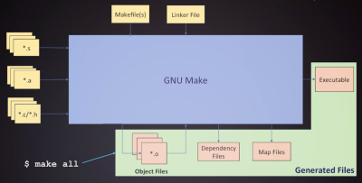

#           GNU Make

We use GNU Make as Build Management Software in MCU Framework. The GNU Make provides
a simple and consistent method for producing a target executable.
It is used to automate whole buid process.

_Automated processes are:_
* **Generating header files**
* **Preprocessing**
* **Assembling**
* **Compiling**
* **Linking**
* **Relocating**
* **Patching**
* **Preparing delivery package**

Allmost every component has own `build.mak` file. It is used for describing which
 sources will part of build process.
There are other mak files with different names (depending of purpose) stored inside
 a `build` folder and subfolders. Depending of conditions, they may be or not
 included in final `makefile`.

Because of fact when the make is executed it looking for `makefile` file,
 all mak files are included with conditions to this `makefile`.
Make process parses the `makefile` and constructs a dependency tree. Based on the desired make target specified
 (or implied) on the command-line, make checks if the dependency files of that target exist.
 And if they exist, whether they are newer than the target itself, by comparing file timestamps.

Before executing the action (commands) corresponding to the desired target,
 its dependencies must be met; when they are not met, the targets corresponding
 to the unmet dependencies are executed before the given make target, to supply
 the missing dependencies.

When a target is a filename, make compares the timestamps of the target file
and its dependency files. If the dependency filename is another target in the Makefile,
make then checks the timestamps of that target’s dependencies. It thus winds up recursively
checking all the way down the dependency tree, to the source code files, to see
if any of the files in the dependency tree are newer than their target filenames.
(Of course, if the dependency files don’t exist, then make knows it must start
executing the make targets from the “lowest” point in the dependency tree, to create them.)

If make finds that files in the dependency tree are newer than their target,
then all the targets in the affected branch of the tree are executed,
starting from the “lowest”, to update the dependency files.
When make finally returns from its recursive checking of the tree, it completes
the final comparison for the desired make target. If the dependency files are
newer than the target (which is usually the case), it runs the command(s) for
the desired make target.

This process is how make saves time, by executing only commands that need to
be executed, based on which of the source files (listed as dependencies) have
been updated, and have a newer timestamp than their target.

Now, when a target is not a filename (like all and clean in our Makefile,
which we called “special targets”), make obviously cannot compare timestamps
to check whether the target’s dependencies are newer. Therefore, such a target
is always executed, if specified (or implied) on the command line.

For the execution of each target, make prints the actions while executing them.
Note that each of the actions (shell commands written on a line) are executed
in a separate sub-shell. If an action changes the shell environment, such a change
is restricted to the sub-shell for that action line only.

For example, if one action line contains a command like `cd newdir`, the current
 directory will be changed only for that line/action. For the next line/action,
 the current directory will be unchanged.

[Home page of help](../../README.md)
