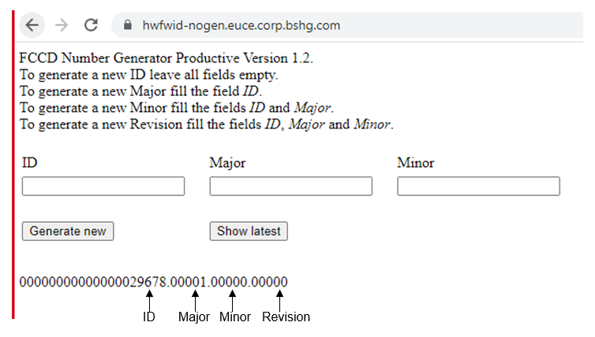

# Getting started - task list after project setup

If your project is already set up, then you need to perform the following tasks. Otherwise, you can find detailed instructions how to set it up here [How to: Setup project](https://wiki.bsh-sdd.com/display/PFS/How+to+Setup+project)

## Tasks to be performed
* **Adapt module header**
* **Adapt hardware ID array**
* **Adapt partition table**
* **Adapt build type**

## Adapt module header

```shell
# Version settings (needed for ModuleHeader)
# if 'version_build' is not defined git hash will be used
uid              = 12345
version_major    = 1
version_minor    = 2
version_revision = 3
#version_build    = 4711
```

This code snippet can be found in `app/[project]/build/project_name.mak` In this section you need to set uid, version_major, version_minor, version_revision and sometimes also version_build. Values for these elements should be generated using the generator, which can be found here [Generator: Number generator](https://hwfwid-nogen.euce.corp.bshg.com/)



These generated values should then be filled in the structure mentioned above.

## Adapt hardware ID array
**(relevant only if BootManager from MCU Framework v1.8.x and lower is used)**

```shell
/* array of supported IDs */
#define FWU_HW_ID_SUPPORT1  {0x01,0x02,0x03,0x04,0x05,0x06,0x07,0x08}
#define FWU_HW_ID_SUPPORT2  {0x02,0x02,0x03,0x04,0x05,0x06,0x07,0x08}
#define FWU_HW_ID_SUPPORT3  {0x03,0x02,0x03,0x04,0x05,0x06,0x07,0x08}
#define FWU_HW_ID_SUPPORT4  {0x04,0x02,0x03,0x04,0x05,0x06,0x07,0x08}
#define FWU_HW_ID_SUPPORT5  {0x05,0x02,0x03,0x04,0x05,0x06,0x07,0x08}
#define FWU_HW_ID_SUPPORT6  {0x06,0x02,0x03,0x04,0x05,0x06,0x07,0x08}
#define FWU_HW_ID_SUPPORT7  {0x07,0x02,0x03,0x04,0x05,0x06,0x07,0x08}
#define FWU_HW_ID_SUPPORT8  {0x08,0x02,0x03,0x04,0x05,0x06,0x07,0x08}
#define FWU_HW_ID_SUPPORT9  {0x09,0x02,0x03,0x04,0x05,0x06,0x07,0x08}
#define FWU_HW_ID_SUPPORT10 {0x0A,0x02,0x03,0x04,0x05,0x06,0x07,0x08}
#define FWU_HW_ID_SUPPORT11 {0x0B,0x02,0x03,0x04,0x05,0x06,0x07,0x08}
#define FWU_HW_ID_SUPPORT12 {0x0C,0x02,0x03,0x04,0x05,0x06,0x07,0x08}
#define FWU_HW_ID_SUPPORT13 {0x0D,0x02,0x03,0x04,0x05,0x06,0x07,0x08}
#define FWU_HW_ID_SUPPORT14 {0x0E,0x02,0x03,0x04,0x05,0x06,0x07,0x08}
#define FWU_HW_ID_SUPPORT15 {0x0F,0x02,0x03,0x04,0x05,0x06,0x07,0x08}
/* magic HW ID, reserved only for debug purposes */
#define FWU_HW_ID_SUPPORT16 {0xDE,0xAD,0xCA,0xFE,0xDE,0xAD,0xCA,0xFE}
```

This is the array of hardware identifiers. Originally, it was used by the BootManager to verify compatibility of SW with a particular HW variant (so-called HW-ID check). HW_IDs described exactly for which hardware variants the software created is compatible. This array can be found in `app\prog\firmware_update\cfg_templates\hw_id_supported.h`

**Note:** If BM from MCU Framework v 1.9.x and higher is used, then this array is not referenced from the module header and therefore not used at all.

## Adapt partition table

A partition is a contiguous memory area with a defined start and end address. **Note:** The partition table will be accessed from different applications. The MCU Framework ensures, that for each application the partition table is linked to the same physical address. You can find all the necessary information (including how to add new partition) here [Partition: Partition table](../../prog/firmware_update/README.md#151-partition)

## Adapt build type 

```shell
# build type (DEVELOP / RELEASE)
build_type    ?= DEVELOP
```
This variable is used to specify build type for application variant(s). For more details refer to file `common/build/help/make_variables.md` or run 'make help' and click on the link 'List of variables' on the main help page. You can modify the value in `app/build/common_config.mak`

[Home page of help](../../README.md)