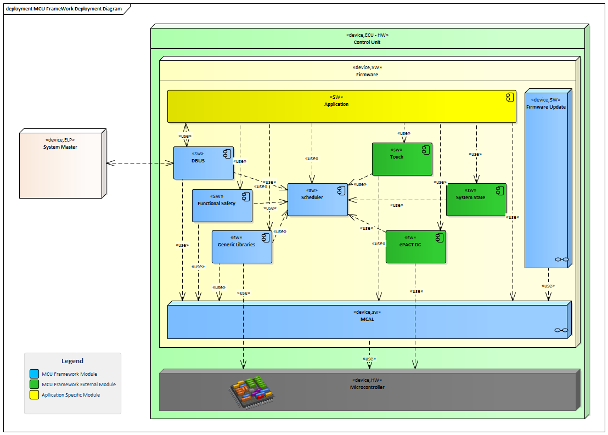
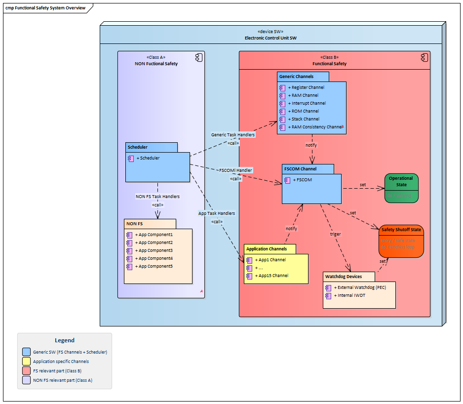
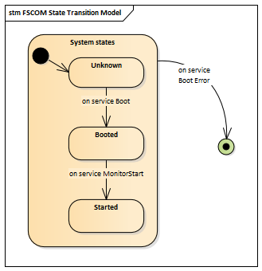
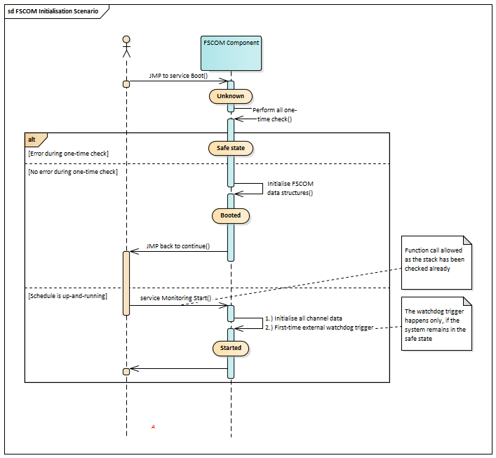
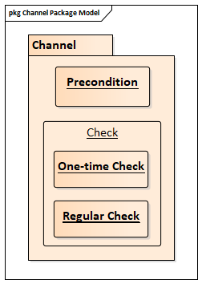
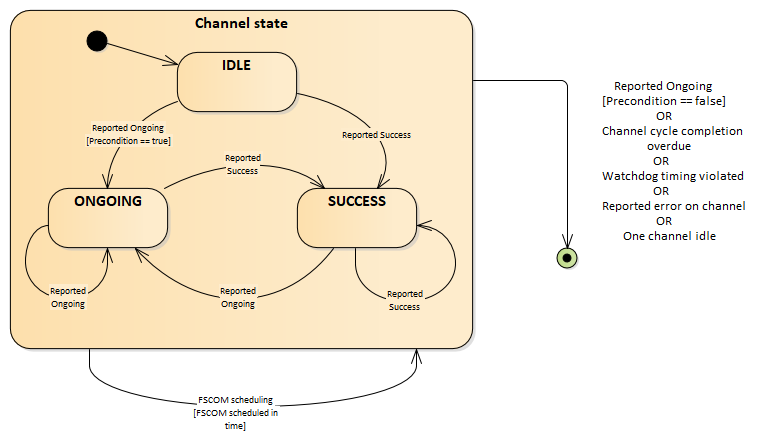

# Functional Safety (FS Class B)

## Content

- [Functional Safety (FS Class B)](#functional-safety-fs-class-b)
  - [Content](#content)
  - [Overview](#overview)
    - [Diagnostics Required by IEC 60730/60335 Class B and Support Status](#diagnostics-required-by-iec-6073060335-class-b-and-support-status)
- [FSF Functional Safety System Overview](#fsf-functional-safety-system-overview)
  - [Architectural Decomposition](#architectural-decomposition)
  - [System Decomposition](#system-decomposition)
  - [External Watchdog](#external-watchdog)
  - [Window Watchod](#window-watchod)
- [Common Functionality - Generic Channels (Generic FS)](#common-functionality---generic-channels-generic-fs)
  - [FSCOM Channel](#fscom-channel)
    - [FSCOM Behaviour](#fscom-behaviour)
    - [FSCOM Configuration](#fscom-configuration)
    - [FSCOM Boot and Initialisation](#fscom-boot-and-initialisation)
    - [FSCOM State Transition Model](#fscom-state-transition-model)
    - [FSCOM Initialisation Scenario](#fscom-initialisation-scenario)
    - [FSCOM Boot Procedure](#fscom-boot-procedure)
    - [Channel Behaviour](#channel-behaviour)
      - [Channel Package Model](#channel-package-model)
    - [FSCOM Provided Services](#fscom-provided-services)
    - [FSCOM Required Services](#fscom-required-services)
    - [Channel State Transition Model](#channel-state-transition-model)
- [Behaviour of Concrete Channels](#behaviour-of-concrete-channels)
  - [RAM Channel](#ram-channel)
    - [Detailed Description](#detailed-description)
  - [ROM Channel](#rom-channel)
    - [Detailed Description](doc/rom_channel.md)
  - [Register Channel](#register-channel)
  - [Stack Channel](#stack-channel)
  - [Inerrupt Channel (ISR)](#inerrupt-channel-isr)
  - [RAM Consistency Channel](#ram-consistency-channel)
  - [Scheduling](#scheduling)
  - [Limited Channel Cycle Time](#limited-channel-cycle-time)
  - [Application Specific Functionality - Application Channels](#application-specific-functionality---application-channels)
    - [How to add Application Specific Channel](#how-to-add-application-specific-channel)
      - [Step 1: Extend the Channel Addressing Enumeration](#step-1-extend-the-channel-addressing-enumeration)
      - [Step 2: Make a task handler known to Scheduler, if needed](#step-2-make-a-task-handler-known-to-scheduler-if-needed)
      - [Step 3: Provide a Pre-condition handler for a channel, if needed (in fSafeXS.c)](#step-3-provide-a-pre-condition-handler-for-a-channel-if-needed-in-fsafexsc)
      - [Step 4: Create a data structure that describes a channel (in fSafeXS.c)](#step-4-create-a-data-structure-that-describes-a-channel-in-fsafexsc)
  - [Implementation - example](#implementation---example)
  - [Headers](#headers)

MCU Framework provides support for Functional Safety checks (FS checks). It's divided into two parts.

- Generic (Generic Function Safety or Generic FS)
- Application specific (Application FS)

## Overview

The use of automated electronic control systems is expanding in recent years, and reliability and safety requirements are becoming important factors in system design. Due to the establishment of the IEC 60730/60335 safety standards for household electronic equipment, home appliances also require automated electronic control design to guarantee safe and reliable operation.

Automated electronic control is also extremely important in the design of microcontroller-based control systems. There are three classes of software for automated electronic control.

1. **Class A:** Control functions that are not intended to be relied upon for the safety of the equipment
Examples: Room thermostats, humidity controllers, lighting controllers, timers, and switches

2. **Class B:** Control functions that are intended to prevent unsafe operation of the controlled equipment
Examples: Thermal cutoff and door locking for laundry machines
3. **Class C:** Control functions that are intended to prevent special hazards
Examples: Automatic burner control and thermal cutoff for sealed equipment

### Diagnostics Required by IEC 60730/60335 Class B and Support Status

|                                         | Standard Number and Section | Location of MCU Diagnostics | Error or Abnormality That Should be Inspected | Supporting FS module of MCU Framework                     |
| --------------------------------------- | --------------------------- | --------------------------- | --------------------------------------------- | --------------------------------------------------------- |
| **1.CPU**                               | 1.1 Registers               | CPU Registers               | Stuck                                         | via Generic FS module SW - test pattern( fsReg.c )        |
|                                         | 1.3 Programme counter       | Program Counter         | Stuck                                         | via IWDT watchdog                                         |
| **2. Interrupt handling and execution** |                             | Interrupt unit              | No interrupt or too frequent interrupt        | via Generic FS module SW ( fsIsr.c )                      |
| **3. Clock**                            |                             | Clock                       | Failure or Wrong frequency                    | via Application FS SW ( Application specific channel )    |
| **4. Memory**                           | 4.1 Invariable memory       | ROM/Flash                   | All single bit fault                          | via Generic FS module SW - CRC ( fsRom.c )                |
|                                         | 4.2 Variable memory         | RAM                         | DC fault                                      | via Generic FS module SW - March C- algorithm ( fsRam.c ) |
| **6. External Communication**           | 6.1 Data                    | Communication port          | Failure or not accurate                       | via Application FS SW ( Application specific channel )    |
| **7. Input/output perihery**            | 7.1 Digital I/O             | Input/Output Port           | Stuck or not accurate                         | via Application FS SW ( Application specific channel )    |
|                                         | 7.2 Analog I/O              | Analog Circuit              | Failure or not accurate                       | via Application FS SW ( Application specific channel )    |
Table 1.0: Diagnostics Required by IEC 60730/60335 Class B and Support Status

# FSF Functional Safety System Overview

## Architectural Decomposition

For a detailed description of the software architecture, please refer to reference [Appliance System and Software Architecture Home](https://production.polarion.bshg.com/polarion/#/project/Architecture_Goals_Features_Abstracts/home)

Only generic software of functional safety is described in this document, including RAM, ROM, and register, stack and interrupt control. Also we are focusing on Class B check implementation.

## System Decomposition

The considered system is decomposed by parts of software with designated responsibility. Particular responsibility is allocated to single channels (rectangles in Figure *Functional Safety System Overview* holds all channel related code and data). The channels are separated into one-time checks (destructive checks) and regular checks. A generic component, FSCOM, provides services that are common to all channels. Each channel notifies FSCOM about ongoing activities, as well as successful or erroneous checks on a periodic basis. In Figure *Functional Safety System Overview* ovals define two global states: Operational (all channels are returning ongoing or successful checks) or Safety-Shutoff (if at least one check is returned with error). As long as the system stays in the operational state, the processor is scheduled either in operational tasks (including the channel checks) or FSCOM. The external watchdog is called periodically by FSCOM. If FSCOM stops servicing the external watchdog, by the external PEC a state change is forced into the safe state “Safety Shutoff”.

Figure 2-1: Functional Safety System Overview

## External Watchdog

In order to control the programm execution (programm counter change) and the correct oscillator frequency (programm execution time) by only one device, a “window watchdog timer” is used as an external watchdog device. Missing watchdog service, or watchdog service that violates the pre-defined frequency of service, leads to the state “Safety Shutoff”. As shown in Figure *Functional Safety System Overview*, the watchdog device is considered private to FSCOM. Since the watchdog itself is implemented by hardware, it is assumed functional within this scope. If the external watchdog is not of type “window watchdog”, the requirement described in chapter 3.2 of input document [1] can’t be fulfilled.

## Window Watchod

The overall point of a Watchdog is to ensure that the firmware is executing as expected. The theory, is that if your firmware can periodically kick the watchdog, then the other functions it is responsible for, are also occurring.

From the system design point of view, they're the last level of fail safe. It's basically saying "we don't know what the system is doing, because it's not able to kick the watchdog. So, reset the device and hope the problem goes away."

They can protect you from accidental infinite loops, stack corruptions, RAM bit twiddles, etc.

A Windowed Watchdog is a better solution than a single-sided Watchdog as the window can protect against more things... For example, with a single-sided, if the loop you're stuck in includes the watchdog kick, you'd never know you had a problem. For a Windowed Watchdog, you have a better chance of resetting due to the likelyhood of kicking too fast...

You'd use a Windowed Watchdog any time you wanted to be reasonably sure that the firmware is doing what it is supposed to, or to fall back to a safe state if it's not. They are generally focused on in safety systems, but all embedded devices can benefit from their use. (For example, a house thermostat is not considered a safety-critical system, however if it completely locks up and requires someone to remove the batteries to restart it that would be an annoyance.)

# Common Functionality - Generic Channels (Generic FS)

## FSCOM Channel

Channels located on top of FSCOM (please refer to Figure *Functional Safety System Overview*) are considered to be common for an MCU, and as such they are considered generic:

- RAM channel
- ROM channel
- Register channel
- Stack channel
- Interrupt channel
- RAM Consistency channel

FSCOM component monitors the system state and manages the external watchdog. It implements the rules, when a system state change has to occur depending on the results that are provided by the channels. Note: the decomposition is not restricted to those seen in the Figure 3.3-1. Application specific channels might be added, depending on the needs of a particular project – as mentioned in chapter 3.1.

### FSCOM Behaviour

### FSCOM Configuration

The set of channels that are known to FSCOM will be configured statically. The information will be located within an area that is addressable by a pre-defined name. The name is to be defined during implementation.

### FSCOM Boot and Initialisation

The FSCOM component provides only two services to be used during boot of an ECU and its initialisation.

| **Service**      | **Meaning**                                                                                                                                                                                                                                                                                                                                                                                                                                                                                                                                                                              |
| ---------------- | ---------------------------------------------------------------------------------------------------------------------------------------------------------------------------------------------------------------------------------------------------------------------------------------------------------------------------------------------------------------------------------------------------------------------------------------------------------------------------------------------------------------------------------------------------------------------------------------- |
| Boot             | This 1st activation of FSCOM is reserved in order to perform all one-time checks, which are destructive. At the end, FSCOM performs initialisation of its internal data structures. This service is NOT allowed to be used during regular scheduling by the scheduler component, as RAM is a resource, which is to be checked for the whole system. Using this service as soon as the system has reached its operational state would be too late. This service may NOT be called, as this would require the stack that can’t be assumed to be functional before completion of the RAM check. |
| Monitoring Start | The scheduler component schedules FSCOM on a regular base. The 1st scheduling cycle is interpreted as monitoring about to start. This requires at least one scheduling cycle for the FSCOM BEFORE all other channels are scheduled. At the end of this cycle, the external watchdog is  serviced at least once.                                                                                                                                                                                                                                                                          |
| Boot Error       | This service is provided in order to move the system into the safe state.                                                                                                                                                                                                                                                                                                                                                                                                                                                                                                                |

### FSCOM State Transition Model

> Description
>
>FSCOM component can’t provide monitoring of channels before initialisation. In state Booted, the external watchdog will not be serviced; hence the boot phase cannot take too long time. In state Started, the external watchdog is serviced. If an error occurs in any state, a transition into the FSCOM final state takes place, which is the safe state.

### FSCOM Initialisation Scenario

> Description
>
>As FSCOM component can’t use the stack at start of this scenario, a symbolic (JMP or GOTO) element is used to reach the provided service. If there is a problem, fall back into safe state takes place. In success case, the FSCOM data structures are initialised and the same symbolic element is used to return, as there was no return address passed.

### FSCOM Boot Procedure

As controller resources cannot be used without a functional check, a detailed check-on-boot procedure is given for a generic type of controller. It is assumed that this generic type of controller has some built-in registers, RAM added (external and/or internal) and the programme storage (external and/or internal). It is further assumed an external watchdog to be present and some peripheral timers and interrupt logic.

The Boot Procedure slightly differs between wired firmware update (WFU) and remote firmware update versions (RFU).

FSCOM Boot Procedure WFU

FSCOM Boot Procedure RFU

> Description
>
> This step-by-step boot procedure has to be started at the very early stage within the systems start up phase, at least BEFORE the variables that are allocated statically by the compiler will be initialised. In the sequence chart of chapter 6.4 in this document, the FSCOM boot procedure has to be performed immediately when control is up to the FSCOM initialisation. On completion of this procedure, the system either has relapsed into the safe state, which has to be handled application-specific, OR the system’s start up phase continues.
>
> >Rationale
> >
> >This procedure starts with the register check, as the RAM check makes use of a pointer register and at least one work register. So, at the end of the register check the pre-condition for the RAM check is fulfilled. Dynamic data (allocated variables and the stack) require the RAM, so the RAM check comes next. After completion of the RAM check, the pre-condition to continue the start up is fulfilled. The stack can’t be checked this early in time as the stack is defined after the boot phase.

### Channel Behaviour

This chapter describes how an abstract channel is statically structured and how it behaves from FSCOM point of view. As FSCOM does not know anything about the internal structure and functionality of a concrete channel, the channels are handled by FSCOM in a generic way. So, concrete channels have to be implemented exactly following the structure and behaviour outlined in this chapter.

#### Channel Package Model

A channel has to implement the package model shown in Figure 7.1-1. A channel package contains all the code and static/dynamic data to access the channel.

### FSCOM Provided Services

| **Service**     | **Meaning**                                                                                                                                                                                                                                                                                                                                                                                                                              |
| --------------- | ---------------------------------------------------------------------------------------------------------------------------------------------------------------------------------------------------------------------------------------------------------------------------------------------------------------------------------------------------------------------------------------------------------------------------------------- |
| Report ongoing  | When a channel starts checking, this event is immediately reported to FSCOM. Each time the channel is processing, it will report ongoing or success to FSCOM. If a channel does not report ongoing (or success), it is assumed not to work correctly. FSCOM keeps a flag for each channel. For ease of implementation, it is recommended to set the ongoing flag also when reporting success (done directly by the report success service). |
| Report success  | If a channel has completed checking (partially or finally) successfully, this event is reported to FSCOM.                                                                                                                                                                                                                                                                                                                                |
| Report error    | If a channel has stopped monitoring due to an error, this event is immediately reported to FSCOM.                                                                                                                                                                                                                                                                                                                                        |
| Report fatal    | This service is provided for channels that require **IMMEDIATE** transition into the safe state. For example, if the register channel has recognised stuck-at fault on the carry flag, then  control immediately has to move to the safe state (Jump instruction).                                                                                                                                                                       |
| Observe channel | A Boolean value is returned by this service. When at least one check cycle has been completed successfully, true is returned, otherwise false is returned.                                                                |

### FSCOM Required Services

| **Service**    | **Meaning**                                                                                                                                                                                                                                                                                                                                                                                                                                                                                                                                                                                                                                                                                                                                           |
| -------------- | ----------------------------------------------------------------------------------------------------------------------------------------------------------------------------------------------------------------------------------------------------------------------------------------------------------------------------------------------------------------------------------------------------------------------------------------------------------------------------------------------------------------------------------------------------------------------------------------------------------------------------------------------------------------------------------------------------------------------------------------------------- |
| Precondition   | In order to determine if all conditions are fulfilled for the actual check to be performed, FSCOM will use the precondition service each time a particular check is ongoing. As preconditions may be composed internally by a large number of single conditions, these are assigned as responsibility of the channel. A precondition simply returns a Boolean value. If the precondition is false, then FSCOM assumes there is an error on this channel and stops servicing the external watchdog. Not all channels have preconditions. In this case, FSCOM assumes all preconditions to be fulfilled at start of the check – because the channel returns true for the preconditions. A detailed example is provided in chapter 8.7 of this document. |
| One-time check | If a one-time check is required on a particular channel (e.g. during booting phase), a onetime check service has to be provided on that channel.                                                                                                                                                                                                                                                                                                                                                                                                                                                                                                                                                                                                      |
| Regular check  | If a regular check is required on a particular channel, a regular check service has to be provided. The scheduler component schedules it regularly.                                                                                                                                                                                                                                                                                                                                                                                                                                                                                                                                                                                                   |

### Channel State Transition Model

The channel state transition model shows the dynamic behaviour of a channel depending on the services used on a particular channel.

> Description
>
> The external watchdog is ONLY serviced by FSCOM, as long as ALL channels remain either in state ONGOING or in state SUCCESS. This model does not consider one-time channels. For regular channels, the state continuously changes. This ensures that regular channels are kept alive. As already mentioned (refer to chapter 7.3), accessing a channel takes place only if the precondition is fulfilled, otherwise the affected channel is considered as erroneous. FSCOM requires to be scheduled fast enough (determined during implementation), otherwise the external watchdog timing is violated. If a channel reports an error, FSCOM immediately stops servicing the external watchdog.

> Rationale
>
> *State IDLE*
>
>- State IDLE is determined by the fact, that an access to a channel starts at one moment in time and completes after a certain time. A channel remains in state IDLE between access completion and start of the next access or just after start of the monitoring. As already mentioned, in state IDLE the external watchdog is not serviced by FSCOM, but the internal watchdog remains serviced.
>
> *Cooperative Scheduling Policy*
>
>- The system's processing time is considered a shared resource among all existing tasks in the system. During implementation, it has to be guaranteed, that the sum of processing time for all tasks does not lead to a violation of the external watchdog determined timing constraints. Currently, this is assured by a limited scheduling latency
>
> *Channel final state*
>
>- In this state, FSCOM enters an indefinite loop without servicing the external watchdog. The internal watchdog remains serviced.

# Behaviour of Concrete Channels

## RAM Channel

Proper function of the complete RAM is checked before starting normal operation. The complete RAM is considered safety relevant, so that a full check of RAM is only possible during the start-up phase. Variables that are identified to be safety relevant, have to be combined and placed into separate segments. During the normal operation, e.g. while running a washing program, those segments get checked periodically.

Precondition : None

One-time check : A full RAM check.

Regular check :

Due to performance reasons, checking the variable segments happens piece by piece. Check cycle limitation (e.g. less then 10 seconds) has to be configured for this check, so that completion is guaranteed by FSCOM. Since this check is destructive, RAM portions need to be saved and restored again. In case of interrupt relevant variables, interrupts must be disabled while checking.

### Detailed Description

[Implementation of package fsRam of library functional safety](./doc/ram_channel.md#)

## ROM Channel

## Register Channel

## Stack Channel

## Inerrupt Channel (ISR)

## RAM Consistency Channel

## Scheduling

FSCOM does not execute the channel checks. Instead, a set of services is provided, which the channels use for communicating the results of the safety checks - only once (boot phase only) or on a regular base. **It has to be guaranteed that the scheduler component within a re-defined span schedules FSCOM component, otherwise a violation of the watchdog re-trigger frequency will occur!**

## Limited Channel Cycle Time

Once a check cycle on a channel has been started, it is assumed this cycle is completed within a pre-defined span. FSCOM manages a timer in order to supervise the cycle run-time to avoid an overdue cycle completion. This monitoring is, of course, not necessary for all channels.

## Application Specific Functionality - Application Channels

### How to add Application Specific Channel

#### Step 1: Extend the Channel Addressing Enumeration

#### Step 2: Make a task handler known to Scheduler, if needed

#### Step 3: Provide a Pre-condition handler for a channel, if needed (in fSafeXS.c)

#### Step 4: Create a data structure that describes a channel (in fSafeXS.c)

## Implementation - example

The **Functional SaFety** module consists of several units:

The generic management part:

- ***fscom.c*** provides boot time and operational services

Pre-defined (micro-controller related) channels:

- ***fsIsr.c*** for checking interrupt service routines
- ***fsRam.c*** for checking RAM
- ***fsRom.c*** for checking ROM
- ***fsStack.c*** for checking the stack
- ***fsReg.c*** for checking the registers

## Headers

fsafe.h contains public (global) information, which is needed when using functional safety library modules.
fspriv.h contains private information and declarations needed for the functional safety library modules.

[howTo.md -> Headers](doc/howTo.md#Headers)

