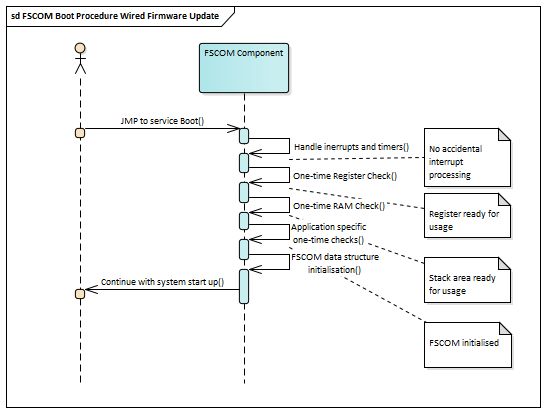
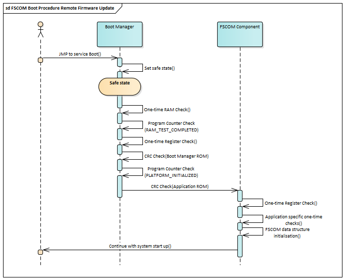

# FSF Functional SaFety

The *Functional SaFety* FSF Library consists of several modules:

The generic management part:

- fscom.c provides boot time and operational services

Pre-defined (micro-controller related) channels:

- fsIsr.c for checking interrupt service routines
- fsRam.c for checking RAM
- fsRom.c for checking ROM
- fsStack.c for checking the stack
- fsReg.c for checking the registers
- fsramcon.c for RAM Consistency check

## Library

For applications that do not make use of the dispatching component, the library itself provides a dispatching function FSF_ucComHandleTask(), that calls all relevant library modules mentioned in the section above.

## Headers

***fsafe.h*** contains public (global) information, which is needed when using functional safety library modules.
```c
/* Channel Adressing Identifiers  */

/*
Since FSCOM does not know details on a particular application, the channels an application
provides will be addressed by its pre-dfined identifier as listed below. Applications are
NOT completely free in allocating identifiers. Points to consider:
1.) Applications have to add their new channels by allocating channel identifiers which have to start from FSF_APP_CHANNEL_0
2.) The order of the FSF_REG_TEST (must always be located at position zero) and the FSF_RAM_TEST  (must always be located at position 1) is fixed and not allowed to change
3.) Channels related to a typical controller (Register, RAM, ROM, Interrupt and Stack)
cannot be used by applications and cannot be replaced freely.
*/

enum    FSF_CHANNEL_ID {


        FSF_REG_TEST                =  0,   //!< ID for reg. checking
        FSF_RAM_TEST                =  1,   //!< ID for RAM checking
        FSF_FIRST_APPL_TEST         =  2,   //!< ID of first oper. test
        FSF_ROM_TEST = FSF_FIRST_APPL_TEST, //!< ID for ROM checking
        FSF_STACK_TEST              =  3,   //!< ID for stack checking
        FSF_ISR_CHECK               =  4,   //!< ID for functional safety interrupt service routine task handler
        FSF_ISR_LATENCY_CHECK       =  5,   //!< ID for interrupt service routine latency monitoring
        FSF_ISR_MIN_FREQUENCY_CHECK =  6,   //!< ID for interrupt service routine minimum frequency check
        FSF_ISR_MAX_FREQUENCY_CHECK =  7,   //!< ID for interrupt service routine maximum frequency check
        FSF_RAM_CONSISTENCY_CHECK   =  8,   //!< ID for RAM variables consistency check
        FSF_APP_CHANNEL_0           =  9,   //!< ID for application channel 0
        FSF_APP_CHANNEL_1           = 10,   //!< ID for application channel 1
        FSF_APP_CHANNEL_2,          = 11,   //!< ID for application channel 2
        FSF_APP_CHANNEL_3           = 12,   //!< ID for application channel 3
        FSF_APP_CHANNEL_4           = 13,   //!< ID for application channel 4
        FSF_APP_CHANNEL_5           = 14,   //!< ID for application channel 5
        FSF_APP_CHANNEL_6           = 15,   //!< ID for application channel 6
        FSF_APP_CHANNEL_7           = 16,   //!< ID for application channel 7
        FSF_APP_CHANNEL_8           = 17,   //!< ID for application channel 8
        FSF_APP_CHANNEL_9           = 18,   //!< ID for application channel 9
        FSF_APP_CHANNEL_10          = 19,   //!< ID for application channel 10
        FSF_APP_CHANNEL_11          = 20,   //!< ID for application channel 11
        FSF_APP_CHANNEL_12          = 21,   //!< ID for application channel 12
        FSF_APP_CHANNEL_13          = 22,   //!< ID for application channel 13
        FSF_APP_CHANNEL_14          = 23,   //!< ID for application channel 14
        FSF_APP_CHANNEL_15          = 24,   //!< ID for application channel 15
        FSF_LASTCHANNEL             = 25,   //!< ID for the last available channel
        FSF_NOCHANNEL               = 26,   //!< ID to be used for not available channel
        FSF_NOT_SPECIFIED_CHANNEL = FSF_NOCHANNEL, //FSF_NOCHANNEL should not be used...
        FSF_EXT_WDOG,               = 27    //!< ID used for external watchdog error (not a specific channel)
        FSF_LASTID                  = 28    //!< Number of channel ID's
};


/** The first channel available for an application will be starting from FSF_APP_CHANNEL_0.
*/

/*=====================================================================================
    Error codes
=====================================================================================*/
enum    FSF_ERROR_CODES {                   //!< FSCOM generated error codes
        FSF_ERROR_OK                =  0,   //!< Service completed successfully
        FSF_ERR_BOOT_FAILURE        =  1,   //!< Cycle failure while boot
        FSF_ERR_FATAL_EXCEPTION,    =  2,   //!< Cycle fatal exception
        FSF_ERR_PRECONDITION_FALSE  =  3,   //!< Precondition returned false for ongoing cycle
        FSF_ERR_CYCLE_OVERDUE       =  4,   //!< Check cycle overdue
        FSF_ERR_WD_TIMING_VIOLATION =  5,   //!< The watchdog timing has been violated
        FSF_ERR_INVALID_RANGE       =  6,   //!< Channel addressing violation
        FSF_ERR_INVALID_STATE       =  7,   //!< FSCOM invalid state
        FSF_ERR_CHANNEL_IDLE        =  8,   //!< Channel remains idle
        FSF_ERR_CHANNEL_ERROR       =  9,   //!< Channel has notified an error
        FSF_ERR_WD_STATE_ERROR      = 10,   //!< Incorrect state read from external watchdog
        FSF_ERR_LATENCY_ERROR       = 11,   //!< Interrupt service routine run time overflow
        FSF_ERR_MAX_FREQ_ERROR      = 12,   //!< Interrupts occurred too often
        FSF_ERR_MIN_FREQ_ERROR      = 13,   //!< Interrupts occurred too little
        FSF_ERR_RAM_CON_IN_ROM      = 14,   //!< RAM variables consistency error in ROM module
        FSF_ERR_RAM_CON_IN_FSCOM    = 15,   //!< RAM variables consistency error in FSCOM module
        };
```

***fspriv.h*** contains private information and declarations needed for the functional safety library modules.
```c

/*=====================================================================================
    Channel states
=====================================================================================*/
enum    FSF_CHANNEL_STATES {
        FSF_CH_STATE_IDLE,          //!< Channel state IDLE (MUST BE ZERO!)
        FSF_CH_STATE_ONGOING,       //!< Channel state ONGOING
        FSF_CH_STATE_SUCCESS,       //!< Channel state SUCCESS
        FSF_CH_STATE_ERROR          //!< Channel state ERROR
};

/*=====================================================================================
    Generic states
=====================================================================================*/
enum    FSF_STATES {
        FSF_STATE_BOOTED,           //!< Generic state BOOTED (MUST BE ZERO!)
        FSF_STATE_PRESCHEDULED,     //!< Generic state PRESCHEDULED (no FSCOM activity this state)
        FSF_STATE_STARTED           //!< Generic state STARTED
};

enum    FSF_SCH_STATES {
        FSF_SCH_INITIALISE,         //!< The pseuo scheduler is about to initialise
        FSF_SCH_CHANNEL,            //!< The pseuo scheduler is about to schedule channels
        FSF_SCH_GENERIC             //!< The pseuo scheduler is about to schedule the generic
};

enum    FSF_ISR_STATES {
        FSF_ISR_CHECK_LONG_INT,     //!< The ISR channel is about to check the long ISR's
        FSF_ISR_CHECK_SHORT_INT,    //!< The ISR channel is about to check the short ISR's
        FSF_ISR_MAINTAIN_CHANNEL    //!< The ISR channel is about to maintain the channel data
};

enum    FSF_ROM_STATES {
        FSF_ROM_CHECK_RESTART,      //!< The ROM channel is about to (re-)start the ROM check
        FSF_ROM_CHECK_ONGOING,      //!< The ROM channel is about to check the ROM
        FSF_ROM_CHECK_FINISH        //!< The ROM channel has stopped checking (ROM-at-once)
};

enum    FSF_STACK_STATES {
        FSF_STACK_INITIALIZE,       //!< The Stack channel is about to initialise the stack
        FSF_STACK_READY             //!< The Stack channel is ready for checking
};

enum    FSF_RAM_STATES {
        FSF_RAM_CHECK_RESTART,      //!< The RAM channel is about to (re-)start the RAM check
        FSF_RAM_CHECK_ONGOING,      //!< The RAM channel is about to check the RAM
        FSF_RAM_CHECK_CHANGE_SEGMENT, //!< The RAM channel has stopped checking
        FSF_RAM_CHECK_FINISH        //!< The RAM channel has stopped checking
};
```

## Excess templates (source files and headers)

The templates are application dependent, i.e. a template may be changed according to project needs.

***fSafeXS.c*** for application specific implementations

***fSafeMcXS.c*** for microcontroller specific implementations

***fSafeXS.h*** for application specific definitions (and possibly application specific function prototypes, however functions, which are needed by the library may not be added in the excess template, as the functions will not be known by compilation of the library).

## Reference to input documents

This design is strongly based on its input document and make use of references to it.

Table of Input documents:
<TABLE style="text-align: center">
<TR style="background-color:rgb(255,255,206)">
<TD>Reference</TD>
<TD>Ducument Title</TD>
<TD>Document Reference Name/Number</TD>
<TD>Version</TD>
<TD>Status</TD>
<TD>Release Date</TD>
</TR>
<TR>
<TD> [1] </TD>
<TD> Functional Safety Software Design document </TD>
<TD> FuncSafeSWSpec.pdf / 5560 0000003770 </TD>
<TD> Version 2.0 </TD>
<TD> Proposed </TD>
<TD> 08.05.2008 </TD>
</TR>
<TR>
<TD> [2] </TD>
<TD> Generic Functional Safety Software Specification</TD>
<TD> GenericFuncSafeSpec.pdf / 5560 0000007751 </TD>
<TD> Version 2.0 </TD>
<TD> Proposed </TD>
<TD> 08.05.2008 </TD>
</TR>
</TABLE>

 ## Generic SW Module
The generic module fscom.c provides all the functions, while fsafe.h provides exported parts. fspriv.h consists of parts locally to the generic module.

 ## Step-by-Step Procedures on how to create the static configuration

## Add more channels
This example is based on chapter 8.7.1 of [1]. It has to be noticed that adding a new channel does not need a recompilation of the library. Instead, extensions have to be made at the top-level header file fsafe.h and the application-dependent implementation file fsApplication.c

### Step 1: Extend the Channel Addressing Enumeration (in fsafe.h)

At the end of the already existing list of channels add two new channels, the Washing Programme Monitor Channel and the Switching Relay Channel.

<pre>
    add FSF_WASH_PROG_MON
    and FSF_SWITCH_RELAY
</pre>

<b> Step 2: Make a task handler known to FSCOM, if needed (in fsafe.h). </b>
Provide a task handler for the scheduler. Add it to the list of already existing scheduler functions.
<pre>
    extern  uint8_t   FSF_ucWashProgMonHandleTask(void);
    extern  uint8_t   FSF_ucSwitchRelayHandleTask(void);
</pre>

<b> Step 3: Provide a Pre-condition handler for a channel, if needed (in fSafeXS.c). </b>
Provide a pre-condition for a channel and make it known to FSCOM. Add it to the external function definitions part.

<pre>
    extern  Bool    FSF_bGetWashProgMonCondition(void);
</pre>

In the example, the washing programme monitor asks the Switching Relay channel about its success status, which is performed by the pre-condition above.

<b> Step 4: Create a data structure that describes a channel (in fSafeXS.c). </b>
At application level, this step requires some questions to be clarified: that is

Q1: does the channel use the check cycle supervision ?

Q2 does the channel provide a one-time check to be executed once while boot-time ?

Q3 does the channel provide a pre-condition to be fulfilled before a transition takes place into state Ongoing?

Q4 does the channel provide a task handler to be called on a regular base


If a channel make use of the check cycle supervision provided by FSCOM, then the data structure member CheckCycleTime holds the check time maximum measured in pieces of 100 milliseconds, otherwise a zero value has to be used.

For the channels mentioned in the example:

It is assumed, that the Switching Realy channel completes a check cycle within less then 100 milliseconds, so this value is set to 1. The multiplier value is also set to 1 as this check does not require a bigger span than the base cycle. The switching relay has to be checked on a regular base, so the flag for this purpose is set true. There is no special pre-condition provided and there is no one-time check to be executed at boot-time. Then, the data structure looks like:


<pre>
const   struct  T_FSCOM_Channel     Switching_Relay_Channel =
        {(uint16_t)1,(uint8_t)1,
        true,
        _FSF_bDefaultPreconditionTRUE,
        _FSF_vDefaultOneTimeCheck};
</pre>

It is assumed, that a Washing Programme completes in a certain time, hence check cycle supervision is configured. In order to recognize an ongoing washing programme, this channel also becomes checked on a regular base. A special pre-condition provides the success status of the Switching Relay channel. There is no one-time check to be executed at boot-time. Then, the data structure looks like:


<pre>
const   struct  T_FSCOM_Channel     Wash_Prog_Monitor_Channel =
            {(uint16_t)MAX_WASHING_PROGRAM_CYCLE,(uint8_t)1,
            true,
            FSF_bGetWashProgMonCondition,
            _FSF_vDefaultOneTimeCheck};
</pre>


<b> Step 5: Complete the application data structure (in fSafeXS.c). </b>

Since FSCOM doesn't know what channels are to service, the number of channels has to be provided together with channel data structures. Correct channel addressing provides the count of channels automatically (FSF_NR_OF_CHANNELS).

<pre>
const   struct  T_FSCOM_Configuration   _FSCOM_Configuration = {
            (uint16_t)FSF_NR_OF_CHANNELS,
            ....parts not of interrest have been omitted
            &Switching_Relay_Channel,       // added the Switching Relay channel
            &Wash_Prog_Monitor_Channel,     // added the Washing Programme Monitor channel
            ....rest of initialisation
            };
</pre>

<TABLE width=900 align=center style="text-align: center"> <TR style="background-color:rgb(255,255,206)">
<TD> <b> RAM Module Configuration  </b> </TD> </TR> </TABLE>
 Create RAM module descriptor and segments to be checked

Controls that describe the RAM configuration 

The RAM configuration will be built at compile-time (make file and its included parts). In the table below, the available set of controls is summarized.

<TABLE align=center style="text-align: center">
<TR style="background-color:rgb(255,255,206)">
<TD>Control </TD> <TD>Meaning </TD> </TR>
<TR> <TD>    OPERATIONAL_RAM_CHECK     </TD> <TD>   If this control exists, when operational the RAM get checked continuously.  </TD> </TR>
<TR> <TD>    MARCH_BUFFER_LENGTH       </TD> <TD>   While checking the RAM, the actual RAM content need to be saved and restored again. For this, a buffer
of fixed length will be used. This control determines the buffer size which is equal to the length of the piece of RAM that is checked per cycle.  </TD> </TR>
</TABLE>

RAM Data structure overview 

Below the basic RAM configurations are shown.

\image html funsafe_RAMConfiguration.jpg

***Step 1: Analyse the RAM structure and what segments need to be checked (fSafeXS.c).***

Most of the micro controller do not provide the RAM as a contiguous area. Special function registers (SFR) are placed in between. In order to solve this
problem, a number of segments may be defined in a table. The number of available segments must be placed inside the RAM module descriptor.

***Step 2: Provide the set of MARCH Patterns to be used (fSafeXS.c).***

Cluster structures of RAM cells differ between types of controllers. Moreover, the RAM get checked byte wise. One commen approach will be usage of four
patterns. Zero-entries (0, the not-inverted pattern) in the left side of the pattern table are: 0x00, 0xF0, 0xCC and 0xAA. One-entries (1, the inverted
pattern) in the right side of the pattern table are: 0xFF, 0x0F, 0x33 and 0x55. Those set of patterns seem to be sufficient for an 8 Bit word size.
The number of available patterns must be placed inside the RAM module descriptor.

***Step 3: Provide a data exchange buffer and its length (fSafeXS.c).***

The data buffer arMarchDataBuffer will be used for data saving and restore. It is recommended to set its size to 8 byte length. This size is sufficient
for most of the micro controllers actually in use.

***Step 4: Provide the RAM channel data structure with limited processing time (fSafeXS.c).*** 

The RAM shall be checked completely within 5 seconds. This limitation holds for only one pattern. Then, following computation is valid: if the RAM channel
get control every 10 milliseconds, then within 5 seconds it is scheduled 500 times, multiplied by a buffer length of 8 byte (see explanation of control
MARCH_BUFFER_LENGTH) results into 4KB every 5 seconds. The time consumed for one check cycle would be 20 microseconds. While checking, interrupts must
be disabled. But, this small amount of processing time does not create problems for most of the applications. So, the RAM channel has to configure its
cycle supervision:

<pre>
        typedef struct  CONST T_FSCOM_Channel FSF_sRAMChannel

        Initial value:

        {(uint16_t)RAM_CYCLE_CHECK_TIME,\
         (uint8_t)1,\
         true,\
         .....
         }

        The RAM channel.
</pre>

<TABLE width=900 align=center style="text-align: center"> <TR style="background-color:rgb(255,255,206)">
<TD> <b> ROM Module Configuration  </b> </TD> </TR> </TABLE>

 Create ROM module descriptors and segments to be checked or excluded

**Supported ROM Memory Models and other things to consider**

The ROM LARGE Model:

It supports **a number of ROM modules** located into diffent banks. So, 32-bit addresses are required. Each ROM module may have multiple segments, so the address ranges need not to be contigues. In this model, different physical ROM modules (ROM directly addressable by CPU and EEPROM accesses by I2C bus) can be mixed.

The ROM channel provides task handlers.

Handling of CRC Errors
<TABLE style="text-align: center">
<TR style="background-color:rgb(255,255,206)" style="color:rgb(193,0,0)">
<TD> <b> SPECIAL NOTICE on how the ROM channel handles CRC errors 

CRC checking is per ROM module. If this check failes for one module, the ROM channel will notify an application about the problem. After that, if the application returns control, the ROM channel does NOT STOP WORKING, instead it will continue checking with the next ROM module, if any. Otherwise, the ROM channel restarts checking with the first ROM module again. </b> </TD> </TR> </TABLE>

Handling externally connected ROM Modules

In case of externally connected ROM, it can't be accessed directly and, before accessed, it has to be checked against it's ready state. The data structure and the ROM channel code support this.

Controls that describe the ROM configuration
The ROM configuration will be built at compile-time (make file and its included parts). In the table below, the available set of controls is summarized. Changes of any of the controls below require to re-compile the library itself. 

<TABLE align=center style="text-align: center">
<TR style="background-color:rgb(255,255,206)">
<TD>Control </TD> <TD>Meaning </TD> </TR>
<TR> <TD> ROM_LARGE         </TD> <TD> A number of different ROM modules will be supported. This kind of configuration make use of the far addressing, if necessary. Since each ROM module has its own CRC value, which might be located anywhere, the ROM data structure holds one additional CRC value reference.   </TD> </TR>
<TR> <TD> ROM_SMALL         </TD> <TD> Only one ROM module will be supported. This kind of configuration basically make use of the near addressing. The CRC value reference is absent, so the CRC value will be placed on a fixed location.  </TD> </TR>
<TR> <TD> ROM_DIRECT_ACCESS </TD> <TD> The library assumes the ROM data to be accessed directly without a ready check before. So, externally connected ROM modules are not supported when this configuration has been choosen </TD> </TR></TABLE>

***ROM Data structure overview***

Below the basic ROM configurations are shown. Due to the lack of an automated analysis, the ROM configuration need to checked and corrected again AFTER EACH BUILD! This is due to the fact, the linker is free to place segements in order to get the code packed on a maximum level.

- **Step 1: Analyse the ROM structure and what modules need to be checked or excluded.**
Lmitations and other things to consider:
**The generator tool does NOT allow to cross the bank border.**

    **Consequences:** as there is no mechanism to solve this problem automatically, crossing segments have to be partitioned manually into smaller segments. So, for ROM modules, in the segment table additonal segments of smaller size have to be created and filled in. For each segment, two pointers have to be provided, the start pointer directs the first byte of the segment, while the end pointer directs the LAST BYTE INSIDE THE SEGMENT. The start pointer must always be equal or less than the end pointer, unpredictable results will occure otherwise.

    **The generator tool does NOT recognise a common address range when banking has been used.**

    **Consequences:** basically, two approaches would exit to solve that problem. First, there is a ROM access procedure in order to return the data read from any bank (preferred solution). Second, the ROM segments to be checked will be placed basically into the common addressing range.

    **The generator tool does NOT consider parts to be excluded.**

    **Consequences:** this is important for parts that need to be patched again after build, i.e. the address range(s) where CRC values will be written (confer the ROM configuratiuon example below).

- **Step 2: Provide a CRC-16 value, one for each ROM module (in fSafeXS.c).**
Only one reference is used to access all CRC data structured in a table. This simplifies placing the position where to patch the ROM image. But, it has to be noted, as this table cannot be part of the CRC-checked data itself, actually, the ROM space reserved for that has to be placed near at the end of the ROM, just before the interrupt vector table starts (proposed solution). 

- **Step 3: Define the number of bytes checked for one scheduling cycle (in fSafeXS.c).**
By the scheduler, the ROM channel gets scheduled regularly. When scheduled, the number of bytes actually checked is limited by the member "Cycle Byte Count". Here, providing the correct configuration value is crucial in order to fulfil the required check time limitation. 

- **Step 4: Provide a ROM data reader and a "ROM ready" checking routine (in fSafeXS.c).**
The current concept provides the flexibility of checking ROM modules of different attributes,like I2C-coupled EEPROM or comparable. For that reason, the ROM channel provides a reference member, pointing to an application-depnedent "data read" function. There, its possible for an application to define its own accessing mechanism. Before reading, the area the ROM channel is about to access, must be ready for reading. Otherwise, the check gets suspended. On the next scheduling cycle,it resumes from the actual position. Since this "ready check" is application dependent, an additional reference is provied for that.

- **Step 5: Finalization (in fSafeXS.c).**
If all parts have been created correctly, provide the number of segments per ROM module and the number of ROM modules. The reference of the ROM module descriptior table will be determined at compile time. Provide all CRC-16[0..N-1] values structured in a table. Its address will be part of an applications make file. 

### **A concrete ROM (LARGE) Configuration Example**
It assumes the ROM memory layout(s) to be described within an applications make file and its included parts. In the table below the ROM segment attribute describes the system area (ROM code 0 and ROM code 1), PT the process technique area, VT the vector table area, BL the Bootloader and DELTA_x a set of exchange data. Then, there must be space reserved for three separate CRC-16 values (2-byte each). At the end of the ROM code 1 area, there is space reserved for up to 8 CRC values (CRC_0 until CRC_7, located from 0xF7F0 until 0xF7FF) and this is considered to be excluded from CRC checking. Then, the configuration would look like below, and the ROM module count will be three. Moreover, an application may use some RAM area to be used for data exchange (Read/Write into flash). Then, the CRC value changes dynamically and is not known at compile time. In the configuration table, those parts are named as DELTA_0 until DELTA_3. Here, for all parts the resulting CRC value get computed at once and changed dynamically, so it is placed into RAM.  But, this CRC value must be guaranteed to be valid as soon the ROM channel starts checking. 

- **How the ROM configuration table looks like**

    Controls set for this type of configuration are: ROM_LARGE, ROM_DIRECT_ACCESS. The resulting library does not support indirect ROM data access, but it supports all the ROM modules as defined. As shown below, this is the default configuration, which might be extended as needed 

<TABLE align=center style="text-align: center">
<TR style="background-color:rgb(255,255,206)">
<TD>ROM Module 0 Segments</TD> <TD>Start Address</TD> <TD>End Address</TD> </TR>
<TR> <TD> ROM Code 0 </TD> <TD> 0x4000   </TD> <TD> 0x7FFF   </TD> </TR>
<TR> <TD> ROM Code 1 </TD> <TD> 0xC000   </TD> <TD> 0xF7EF (16 byte reserved)   </TD> </TR>
<TR> <TD> BL         </TD> <TD> 0xFC00   </TD> <TD> 0xFDFF   </TD> </TR>
<TR> <TD> VT         </TD> <TD> 0xFF80   </TD> <TD> 0xFFFF   </TD> </TR>
</TABLE>

<TABLE align=center style="text-align: center">
<TR style="background-color:rgb(255,255,206)">
<TD>ROM Module 1 Segments</TD> <TD>Start Address</TD> <TD>End Address</TD> </TR>
<TR> <TD> DELTA_0    </TD> <TD> 0x3A8000 </TD> <TD> 0x3A83FF </TD> </TR>
<TR> <TD> DELTA_1    </TD> <TD> 0x3A8400 </TD> <TD> 0x3A87FF </TD> </TR>
<TR> <TD> DELTA_2    </TD> <TD> 0x3A8800 </TD> <TD> 0x3A8BFF </TD> </TR>
<TR> <TD> DELTA_3    </TD> <TD> 0x3A8C00 </TD> <TD> 0x3A8FFF </TD> </TR>
</TABLE>

<TABLE align=center style="text-align: center">
<TR style="background-color:rgb(255,255,206)">
<TD>ROM Module 2 Segments</TD> <TD>Start Address</TD> <TD>End Address</TD> </TR>
<TR> <TD> PT         </TD> <TD> 0x3AB000 </TD> <TD> 0x3ABFFF </TD> </TR>
</TABLE>

    For the process technique (PT), the CRC value will be placed within the 24-bit address range. Other CRC values will be allocated within the 16-bit address range, namely CRC_0 for all parts located in the 16-bit address range. Those get excluded from checking.
    The CRC value for the DELTA buffers will be placed in RAM, thus excluded automatically.

- **How the CRC values will be created and the ROM image gets patched**

    For parts located in the 16-bit addressing range, creation is comparable to the small configuration. For parts located in the 24-bit addressing range, the resulting CRC value has to be located within the data structure as shown below. This data structure is placed at 0x3AB000 (it's PT location). The CRC generation tool does not allow to use expressions. Moreover, it does not allow synonyms to be used, which may be used in order to solve differences between configurations. Thus, the location of the Checksum must be computed manually and it will be: 0x3AB000 + SIZE_OF_VERSION_INFO (36).

<pre>
    typedef struct
    {
        uint8_t VersionInfo[SIZE_OF_VERSION_INFO];
        uint16_t Checksum;
        uint8_t NumberOfTables;
        void  *VectorAddresses[CNT_OF_VECTORS];
    } StructVectorTab;
</pre>
    For the DELTA areas, there is one variable defined where the CRC value has to be stored.

<TABLE align=center style="text-align: left" style="background-color:rgb(255,255,206)">
<TR> <TD> xcrc.exe <S-Record file> /S /C004000-007FFF /C00C000-00F7EF /C00FC00-00FDFF /C00FF80-00FFFF  /D00F7F0 </TD> </TR>
<TR> <TD> xcrc.exe <S-Record file> /S /C3AB000-3AB023 /C3AB026-3ABFFF /D3AB024 </TD> </TR>
</TABLE>


<TABLE width=900 align=center style="text-align: center"> <TR style="background-color:rgb(255,255,206)">
<TD> <b> Stack Configuration  </b> </TD> </TR> </TABLE>

## Define the stack, its location and magic entries

<TABLE style="text-align: center">
<TR style="background-color:rgb(255,255,206)" style="color:rgb(193,0,0)">
<TD> <b> First of all, there is one limitation to be noticed: Actually, the stack channel assumes that local variables be placed on the hardware stack. Its location depends on the type of controller in use. So-called "compiled stacks" are not supported currently. If necessary, the concept has to be extended for that. </b> </TD> </TR> </TABLE>

Below, an overview is given on how the stack is structured and where the magic number will be written.

In order to describe the data structure, basically three parameters have to be provided by an
application , that is:

<pre>

extern  CONST T_Stack   _FSF_Stack[1];
extern  CONST uint16_t  _FSF_ui16StackMagic;
CONST uint16_t  _FSF_ui16StackMagic   = (uint16_t)STACKMAGIC;

</pre>
Initialisation values will be taken from application specific build process (make file). Magic numbers will be written into the first and the last stack location and they get checked continousely while the system runs in its operational state.

- Portability Issue
Depending on the architecture of the actual controllers , while operation the stack may grow in any direction. In order to keep the code portable, it has to be kept in mind, the first address of the stack area must be greater than the last address of the stack area.

<TABLE width=900 align=center style="text-align: center"> <TR style="background-color:rgb(255,255,206)">
<TD> <b> Interrupt Configuration  </b> </TD> </TR> </TABLE>

## Define the interrupt configuration, its types and limitations

<TABLE style="text-align: center">
<TR style="background-color:rgb(255,255,206)" style="color:rgb(193,0,0)">
<TD> <b> There are some assumptions to be noticed:
<ul>
<li> Interrupts are not allowed to occur in a nested manner. Otherwise, they can't be checked and measured as required. Confer chapter "Interrupts" of [2]. Existing application designs that do not follow this rule have to be changed respectively. </li> 
<li> The interrupt supervision interval cannot exceed 16,77 seconds. </li>
</ul>
</b> </TD> </TR> </TABLE> 

Interrupts will be classified by
- Short running interrupt service 
    Event counters are typical example for this kind of service. They get incremented or decremented per occurrence. So, for short running services, it does not make sense to supervise its execution time.

- Long running interrupt service
    There is some functionality assigned to this type of interrupt, so its execution time need to be supervised.

- Spurious interrupt service
    Unused interrrupts have to be assigned to one or more interrupt handling routine(s). These kind of interrupts have to be supervised too, as they may block the system from operational service (i.e. constantly received NMI). This class of interrupts need no special treatment, Instead, they may be handled like the short interrupt class (simple event counter).

**Things to be supervised**

It has to be guaranteed, **the number of received interrupts** lies between predefined limts. That means, for **a given supervision (time) interval**, they cannot occur too often or few. For example, spurious interrupts are not allowed to occur, so the upper limit (max.) has to be configured to one. This means, an exception will be raised if it happened once or more times. It has also to be guaranteed, the **run length of an interrupt service routine** does not exceed a prefined limit. In order to gather the necessary data,the functional safety generic provides three interfaces to be placed within the application-specific interrupt service routines, that is

**Notify entering a long running interrupt service routine**

<pre>
void FSF_vIsrDoEntry(uint8_t ucIsrId)
</pre>
<b> Notify exit of an long running interrupt service routine </b>
<pre>
void FSF_vIsrDoExit(uint8_t ucIsrId)
</pre>
<b> Notify entering a short running interrupt service routine </b>
<pre>
void FSF_vIsrDoShortEntry(uint8_t ucIsrShortId)
</pre>

An overview of the interrupt data structure is given below. Basically, the number of interrupts to be checked is not limited by the functional safety generic.

<TABLE align=center style="text-align: center">
<TR style="background-color:rgb(255,255,206)">
<TD>Configuration Element </TD> <TD>Meaning </TD> </TR>
<TR> <TD> ISR Run length </TD> <TD> Measured in microseconds </TD> </TR>
<TR> <TD> At least </TD> <TD> Minimum number of interrupt expected within the supervision interval </TD> </TR>
<TR> <TD> No more </TD> <TD> Maximum number of interrupt allowed within the supervision interval <b>Reaching this limit forces an exception!</b> </TD> </TR>
<TR> <TD> Supervision interval </TD> <TD> Measured in pieces of 256 microseconds </TD> </TR>
<TR> <TD> Control </TD> <TD> Used to configure what has to be checked: maximum, minimum and/or latency </TD> </TR>
</TABLE>

Note: for the short running interrupt service, the "ISR Run length" row will be absent. The first four places (in the graphics Interrupt 0 until Interrupt 3) can't be configured freely. They are reserved for communication interrupts. The rest is free to be occupied by applications.


- Controls that describe the interrupt configuration

    The interrupt configuration will be built at compile-time (make file and its included parts). In the table below, the available set of controls is summarized. Changes of any of the controls below require to re-compile the library itself.

<TABLE align=center style="text-align: center">
<TR style="background-color:rgb(255,255,206)">
<TD>Control </TD> <TD>Meaning </TD> </TR>
<TR> <TD> FS_USE_SHORT_ISR_CONTROL </TD> <TD> Provide support for short running interrupt service </TD> </TR>
<TR> <TD> FSF_ISRCONFIG </TD> <TD> Provide support for interrupt configuration </TD> </TR>
</TABLE>

<TABLE width=900 align=center style="text-align: center"> <TR style="background-color:rgb(255,255,206)">
<TD> <b> Task Scheduling Configuration  </b> </TD> </TR> </TABLE>

## Step-by-Step Procedure on how to configure the dynamic aspects

This part concerns channels that are scheduled on a regular base, which is not necessarily the case (confer the RAM channel). As outlined in [1], a separate component schedules registered components according the configured execution priority.

There is one overall limitation that has been taken into consideration: while operational work, the run length  of the generic and its assigned channel do not exceed the 1 milliseconds limitation. Bigger tasks have been split into pieces of smaller tasks. While boot time, this limitation does not hold.

## How the pseudo scheduler has to be configured
Unfortunately, some applications do not make use of the general scheduling feature (the so-called <b> pseudo scheduler </b>). For those, the functional safety generic provides this feature, with the limitations that

- **Registered components cannot change their priority dynamically at runtime**
- **Dynamic task termination doesn't work**
- **Dependecies between components will not be taken into consideration**

There is one exception from the last statement above: the pseudo scheduler executes components call by call, starting with the first component in the table until the last onne. If one of the components return control with the return value TASK_NOT_INITIALISED, the pseudo scheduler immediately stops execution and, on next activation, it restarts execution again with the first component in the given table. So, in case of a problem an application is able to change the actual path of execution at runtime, simply by a change of the actual table of components. In order to achieve this behaviour, the pseudo scheduler still provides the necessary interface and it follows the same signature and semantics as the real scheduler does. That is

<pre>
    <b> Change the current path of execution to an alternative one </b>
        void SCH_vSetMainStateTable(const TschMainTaskTable* ptMainTbl)

    <b> Do one scheduling cycle for all registered components </b>
        bool SCH_bHandleTask(void)
</pre>

## How the real scheduler has to be configured

- **Step 1: Make the module(s) known to the scheduler (in schedDef.h).**
    As functionality is allocated to channels, one task has to be reserved for one channel of dedicated functionality. If functionality is the same, but for different objects, this is the case for measurement of interrupt latency and run-length, there only one channel may exist providing configurable attributes.

<pre>
enum {
    ...
    MOD_<last existing one>,
    MOD_WMCH,           // the Washing Monitoring channel
    MOD_SRCH,           // the Switching Relay channel
    ...
    NUMBER_OF_MODULES    //last entry, do not change
    },
</pre>

    Make the scheduling table known were the channels task handlers are linked in. In case of a washing machine, the both channels mentioned above will be part of the main washing table.


    Think about the task dependencies. For functional safety and the channels managed, at least the timer task must be up-and-running, hence all modules will have at least this dependency. For each channel, its dependecy table has to be exported to the task scheduler.

<pre>
extern const TtaskId FSF_ptWMCH_Dep[];
extern const TtaskId FSF_ptSRCH_Dep[];
</pre>

- **Step 2: Create a task dependency table (in schedDef.c).**
    Functional safety itself depends on the timer task. Here, its sufficient that both channels depend only on the functional safety task.

<pre>
const TtaskId FSF_ptWMCH_Dep[] = {DEP_FSF SCH_END_MARK};
const TtaskId FSF_ptSRCH_Dep[] = {DEP_FSF SCH_END_MARK};
</pre>

    Link it into the global task scheduler's dependency table (Note: take care of its position!).

<pre>
const TtaskId* const SCH_pptDependencyListPtrTable[ NUMBER_OF_MODULES ]={
    ...
    FSF_ptWMCH_Dep,     // placed on position of MOD_WMCH
    FSF_ptSRCH_Dep,     // placed on position of MOD_SRCH
    ....
    };
</pre>

- **Step 3: Add task handlers to the global task entry table (in schedDef.c).**
The scheduler excecutes code that is linked in into this table (Note: take care of its position!).

<pre>
const TpfTaskHandler SCH_ppfTaskHandlerTable[ NUMBER_OF_MODULES ] ={
    ...
    WMCH_bHandleTask,     // placed on position of MOD_WMCH
    SRCH_bHandleTask,     // placed on position of MOD_SRCH
    ...
    };
</pre>

- **Step 4: Add task priorities to the global task priority table (in schedDef.c).**
For a channel its not allowed to remain in the state idle. If so, the system immediately changes into safe state. Hence, all channels have to be executed at least once BEFORE scheduling of the functional safety task. This is guaranteed, if channels in general get the high priority assigned, while the functional safety task get the low priotity assigned (Note: take care of its position!).

<pre>
const TschMainTaskTable SCH_tMainDoWashingTable[ ]={
    ...
    MOD_WMCH, SCH_PRIOR_HI,     // placed on position of MOD_WMCH
    MOD_SRCH, SCH_PRIOR_HI,     // placed on position of MOD_SRCH
    ...
    };
</pre>

## The Functional Safety Boot process
Controller resources need to be checked at boot time. The boot procedure is outlined here.

- ***Wired Firmware Update Boot Scenario (WFU/FW1)***

   
- ***Remote Firmware Update Boot Scenario (RFU/FW3)***
  
   

It starts with the register check, as the RAM check makes use of a pointer register and at least one work register. So, at the end of the register check the pre-condition for the RAM check is fulfilled. Dynamic data (allocated variables and the stack) require the RAM, so the RAM check comes next. After completion of the RAM check, the pre-condition to continue the start up is fulfilled. The stack can't be checked this early in time as the stack is defined after the boot phase.

## Structured Description of Library Functional Safety

tbd
