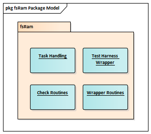

# 1. Implementation of package fsRam of library functional safety.

 The RAM area of a controller is checked by this task. Its responsibility is separated into one task that is supposed to be so-called one-time check, which is only active at startup of a controller, and the task handler, which is supposed to check the RAM at normal operational work.

 ## 1.1. Functional Safety RAM Check Component - Top-Level Design
 

> Description
>
> The fsRam package provides the parts outlined in the model. By compilation switch, the Ram task may run either in the usual operating mode or in test harness mode. When running in the usual operating mode, the test harness part will not be linked to the package. When running in test harness mode, stub services are provided, so the real RAM checking interface is separated from being called and only the test server will be able to call it.
 
> Rationale
> 
> At normal operational work, checking the whole RAM at once is not possible, or is at least a very difficult task. For that reason, it was decided to perform a full RAM ckeck at startup only. Below, an overview of the used test algorithm is provided, for possible comparison with some other public algorithms. Fault models can be found at the respective internet locations. 

## 1.2. One-time (start-up) RAM March C test

The whole RAM space is alternately checked and filled word by word with background
patterns (value 0x00000000) and inverse background patterns (value 0xFFFFFFFF) in six
loops.

1. (↑w0)
2. (↑r0w1)
3. (↑r1w0)
4. (↓r0w1)
5. (↓r1w0)
6. (↑r0)
  
The first three loops are performed in incremental order of addresses, fourth and fifth in decremented reverse order and the last again in incremental order. The order of tested addresses is scrambled, as it respects the physical order of addresses to better prevent and recognize any cross-talk between physically adjacent memory cells. The scramble principle is shown in Table 3. The basic physical unit is a pattern (a row) covering a block of 16 words. The numbers in the table cells represent logical addresses while their order in the table represents the physical layout. Bold frames highlight the places where the logical order is scrambled.

## 1.3. On-going (normal operation) RAM March C test
The RAM check task is implemented using assembler language with a portable C-wrapper function on its top, thus it depends on the type of controller.

During normal operational work, the March-C algorithm is used to continue checking the RAM. As this algorithm is efficient and very easy to handle, checking the whole RAM is possible to perform within a few seconds for a given check pattern (actually we use 2 different). Moreover, RAM portions get checked by overlapping the last byte of the actual buffer, hence recognition of cross-talk between portions will also be possible. 

**Input Document Reference(s)**
 
 <TABLE style="text-align: center">
 <TR style="background-color:rgb(255,255,206)">
 <TD>Reference</TD>
 <TD>Ducument Title</TD>
 <TD>Document Reference Name/Number</TD>
 <TD>Version</TD>
 <TD>Status</TD>
 <TD>Release Date</TD>
 </TR>
 <TR>
 <TD> [1] </TD>
 <TD> Functional Safety Software Design document </TD>
 <TD> FuncSafeSWSpec.pdf / 5560 0000003770 </TD>
 <TD> Version 2.0 </TD>
 <TD> Proposed </TD>
 <TD> 08.05.2008 </TD>
 </TR>
 <TR>
 <TD> [2] </TD>
 <TD> Generic Functional Safety Software Specification</TD>
 <TD> GenericFuncSafeSpec.pdf / 5560 0000007751 </TD>
 <TD> Version 2.0 </TD>
 <TD> Proposed </TD>
 <TD> 08.05.2008 </TD>
 </TR>
 </TABLE>

Functions:

```c
uint8_t FSF_ucRamHandleTask(void)
void FSF_vRam_OneTimeCheck(void)
void FSF_vRam_OperationalException(void)
void FSF_vRam_FatalException(void)

STATIC void vRamOpercheck(uint8_t * pucRAM, uint8_t * pucDEXBuffer, uint8_t ucPatNoInv, uint8_t ucPatInv)
STATIC void vRAMCheckOngoing(void)
STATIC void vRAMCheckSuccess(void)
```

Type definitions of control structures:

```c
/** The RAM Segment descriptor */
typedef struct _T_RAM_Segment{
    uint8_t * pucStartSeg;  //!< Pointer to start of RAM segment
    uint8_t * pucEndSeg;    //!< Pointer to end of RAM segment
} T_RAM_Segment;

/** The Check Pattern descriptor */
typedef struct _T_RAM_Pattern {
    uint8_t ucPatNotInv; //!< Pattern not inverted
    uint8_t ucPatInvers; //!< Pattern inverted
} T_RAM_Pattern;


/** The RAM Module descriptor */
typedef struct _T_RAM_Module {
    uint8_t ucBufferLength; //!< Length of data exchange buffer
    uint8_t ucSegmentCount; //!< Count of segments in that table
    uint8_t ucPatternCount; //!< Count of patterns used for the RAM check
} T_RAM_Module;
```

The example of definition:

```c
/**
  RAM Data Exchange Buffer
*/
#ifndef WIN32
SYMBOL_USED uint8_t FSF_arMarchDataBuffer[MARCHBUFLENGTH];
#endif

/**
  RAM Segment Table. Its content has been defined as part of a project.inc
  Segments have to be aligned to 4 !!!
*/
CONST T_RAM_Segment FSF_atRamSegments[] = {
    {(uint8_t *)RAM1_PHY_START, (uint8_t *)RAM1_PHY_END},
    {(uint8_t *)RAM2_PHY_START, (uint8_t *)RAM2_PHY_END},
    {(uint8_t *)RAM3_PHY_START, (uint8_t *)RAM3_PHY_END},
};

/**
  RAM Configuration:  table of check patterns
*/
CONST T_RAM_Pattern FSF_asPatternTable[] = {
    {MARCH_PATTERN_0_0, MARCH_PATTERN_1_0},
    {MARCH_PATTERN_0_1, MARCH_PATTERN_1_1}
};

/**
  The RAM Module descriptor
*/
CONST T_RAM_Module FSF_atRamModule = {
    (uint8_t)5,
    (uint8_t)(sizeof(FSF_atRamSegments) / sizeof(T_RAM_Segment)),
    (uint8_t)(sizeof(FSF_asPatternTable) / sizeof(T_RAM_Pattern))
};

```

