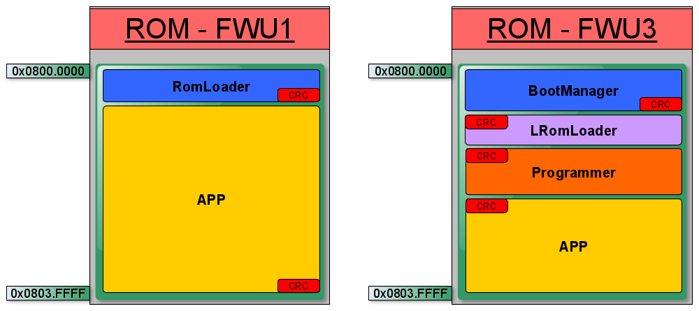
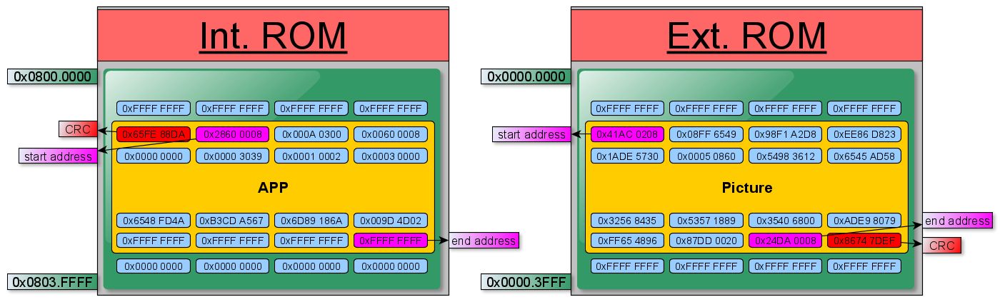
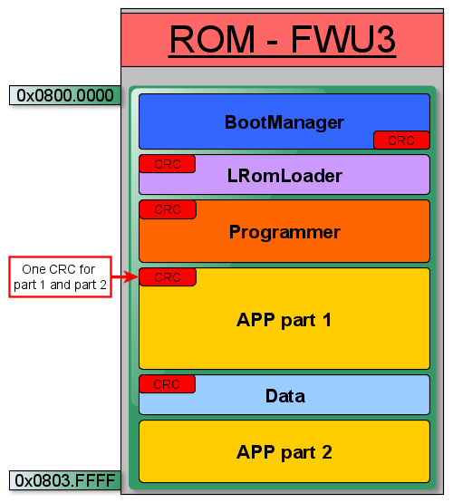
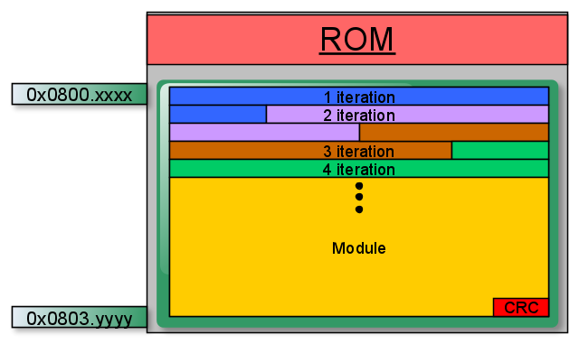
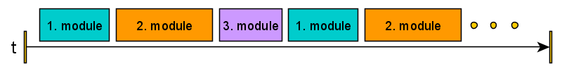
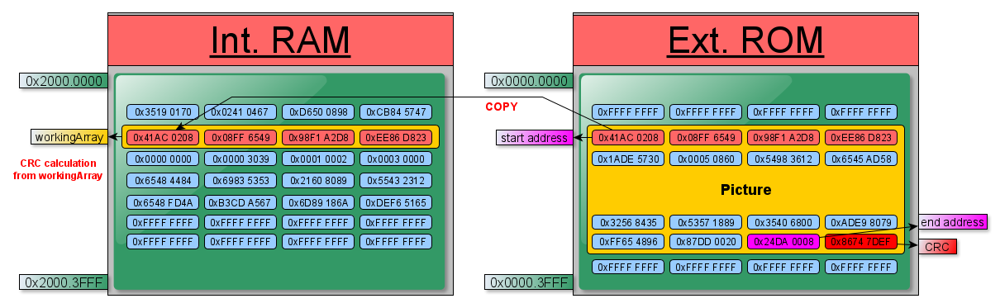

# ROM channel

The ROM channel checks the integrity/consistency of the ROM memory module/segment via CRC calculation.

This check is not destructive.


## 1. Purpose:

* detect all single-bit faults
* detect violation of integrity/consistency of ROM memory module (some bit/byte can be rewritten by an attacker)


## 2. Checking:

The integrity of the ROM memory module is checked by CRC calculation.

**<span style="color: red;">The NVMEM memory area must be excluded from CRC calculation because CRC will be changed and the ROM check fails.</span>**

There is a different placement of CRC for FWU1 and FWU3.
* **FWU1 (Wired update)** - CRC is stored at the end of the memory module
* **FWU3 (Remote update)** - CRC is stored at the beginning of the memory module inside SW module header **MDHD_ModuleHeader** except BootManager




The ROM channel alias "ROM check" calculates the CRC of a memory module from START to END address and compares it with CRC stored in ROM. Of course, CRC is excluded from the calculation. If calculated CRC and stored CRC is not equal then an error is reported.

When Functional Safety has enabled, the Application and the BootManager (or the romLoader) are tested automatically,  without additional configuration.

If users in a project want to add a new segment, then it's necessary to create a new segment (similar to **<span style="color: red;">FSF_atRomSegments_0[]**</span>) and add into table **<span style="color: red;">FSF_atRomModules[]</span>** (the file app/prog/FuncSafe/fSafeXS.c)


Properties of CRC calculation:

* CRC size = 32 bit<br>
* Init value = 0xFFFFFFFF<br>
* Polynom value = 0x04C11DB7<br>
* ROM_CRC_STEP = 32 words = 128 bytes  -> Number of words that are processed per one cycle

*Note: Almost all platforms use the hardware unit for CRC calculation. If there is some reason why the concrete platform can not use a hardware unit (PSOC - HW CRC not available), then a standard software CRC library is used.*
<br><br>



### FWU1 - Romloader
* There is no ROM check.
<br><br>

### FWU3 - BootManager
* StartUp ROM check of BootManager itself.
* Integrity check of module which will be executed + all relevant partitions (configuration data partition ...)
<br><br>

### Application

* StartUp (One Time) check:
  * FWU1 - check of the **Application** and the **romLoader**
  * FWU3 - check of the **BootManager** (the Application is checked by the BootManager)
<br><br>
* RunTime (Continuous) check:

  * FWU1 - check of the **Application** and the **romLoader**
  * FWU3 - check of the **Application** and the **BootManager**

<br>
The Application SW memory module has only one CRC stored at the beginning of the memory module. 
<br>
Even if the user splits the Application into two parts (which could be non-continued space), it still has only one CRC for both part 1 and part 2.
<br>



<br>
<br>

### StartUp (OneTime) check
* The whole ROM module is checked at once.

### RunTime (Continuous) check
* ROM module is checked piece by piece. In each iteration of the scheduler, the FS inspects the ROM module one piece of the module. 
(Default size of the one piece is ROM_CRC_STEP = 32 words = 128 bytes)

<br>
* Checking of modules is executed sequentially. It means at the beginning, the 1-st module is checked,  then the 2nd module and 3rd module. The process repeats: the 1-st, 2-nd, etc. again.
Modules are not checked parallelly.




### External ROM
Functional Safety can also check external Flash. The CRC calculation is performed piece by piece. It's necessary to copy a part of the external flash memory to a working array in internal RAM.<br>
Then working array is used for CRC calculation.<br>



<br>
A project must have implemented reading functions of external memory, which can communicate by (i2c, SPI, ... )<br>
Typedef of function pointer:

```c
typedef bool (*T_ROM_Ready)(uint8_t DATAMODEL * FAR, uint16_t ); 
typedef uint8_t *(*T_ROM_Read) (uint8_t *, uint16_t );
```

Example of interfaces:
```c
/* Check, if external memory is ready for reading.
   \param  uint8_t*   ROM address from where to read
   \param  uint16_t   length of data about to read
   \return bool       true, if ext. memory is ready for reading
*/
bool I2C_bIsROMReady(uint8_t *pData, uint16_t ui16length){}

/* Read data from external memory.
   \param  uint8_t*   ROM address where to read from
   \param  uint16_t   length of data to read
   \return uint8_t *  address of data that have been read, or NULL
*/
uint8_t* I2C_pucReadROMData(uint8_t *pSrc, uint16_t ui16length)
```

After that, it's also necessary to add those functions (the pointers) into the table **FSF_atRomModules[]**.
```c
/* ROM settings */
FSTH_CONST T_ROM_Module FSF_atRomModules[] = {
    ... //existing entries
    {
        &(FSF_mySegment[0]),
        1u,   // only 1 segment
        (uint8_t)ROM_CRC_STEP, 
        (T_ROM_Read)I2C_pucReadROMData,
        (T_ROM_Ready)I2C_bIsROMReady,
        (uint32_t*)MY_CRC_ADR
    },
};
```


## 3. Configuration:


For calculation is necessary define:
* **START** address
* **END** address
* **CRC** address (The CRC itself must be excluded from the calculation)

Default MCU Framework segment table:

```c
/* \app\prog\FuncSafe\fSafeXS.c */

FSTH_CONST T_ROM_Segment FSF_atRomSegments_0[] = {
    /* BootLoader ( BootManager or romLoader ) */
    {(uint8_t*) FS_BL_START_ADR, (uint8_t*) FS_BL_END_ADR},
    /* APP */
    {(uint8_t*) FS_APP_START_ADR, (uint8_t*) FS_APP_END_ADR},
}; 
```
The default configuration is already done for App and bootloader (romLoader - FWU1 / BootManager - FWU3).

For additional modules, it's necessary to add a new module into FSF_atRomModules and create a new segment table with boundaries.
```c
FSTH_CONST T_ROM_Segment FSF_mySegment[] = {
    {(uint8_t*) MY_START_ADR, (uint8_t*) MY_END_ADR},
};
```

It's possible to add more segments which have common CRC.
```c
FSTH_CONST T_ROM_Segment FSF_mySegment[] = {
    {(uint8_t*) MY_START_ADR_1, (uint8_t*) MY_END_ADR_1},
    {(uint8_t*) MY_START_ADR_2, (uint8_t*) MY_END_ADR_2},
};
```

After that, it's also necessary to add the new segment to the table **FSF_atRomModules[]**.

The CRC is calculated only for the module, but one module can have **several segments**.
```c
/* \app\prog\FuncSafe\fSafeXS.c */

FSTH_CONST T_ROM_Module FSF_atRomModules[] = {
    {   &(FSF_atRomSegments_0[0]),
        1u,
        (uint8_t)ROM_CRC_STEP, 
        (T_ROM_Read)_FSF_pucReadROMData,
        (T_ROM_Ready)_FSF_bIsROMReady,
        (uint32_t*)FS_BL_CRC_ADR
    },
    {   &(FSF_atRomSegments_0[1]),
        1u,
        (uint8_t)ROM_CRC_STEP, 
        (T_ROM_Read)_FSF_pucReadROMData,
        (T_ROM_Ready)_FSF_bIsROMReady,
        (uint32_t*)FS_APP_CRC_ADR
    },
    {   &(FSF_mySegment[0]),
        1u,   //<- only one segment, set "2u" in case of two segments with one CRC
        (uint8_t)ROM_CRC_STEP, 
        (T_ROM_Read)_FSF_pucReadROMData,
        (T_ROM_Ready)_FSF_bIsROMReady,
        (uint32_t*)MY_CRC_ADR
    },
};
```

When the module is stored in internal ROM, then as read functions are used **\_FSF_pucReadROMData()** and **\_FSF_bIsROMReady()**. 
<br>


The function always returns the source address (\***pSrc**) because reading data via I2C or SPI is unnecessary.

```c
uint8_t* _FSF_pucReadROMData(uint8_t* pSrc, uint16_t ui16length) 
{
    (void)ui16length;
    return (uint8_t*) (void*)pSrc;
}
```

<br>

The function always returns **true** because an internal **ROM is always ready**.
```c
bool _FSF_bIsROMReady(uint8_t *pData, uint16_t ui16length) 
{
    (void)*pData;
    (void)ui16length;
    return true;
}
```

Those functions should be untouched.

[Back to Functional Safety Homepage](../README.md)
