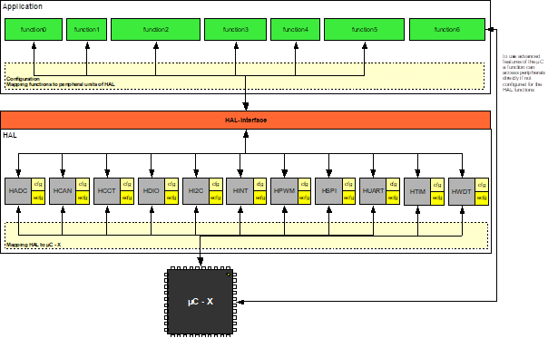
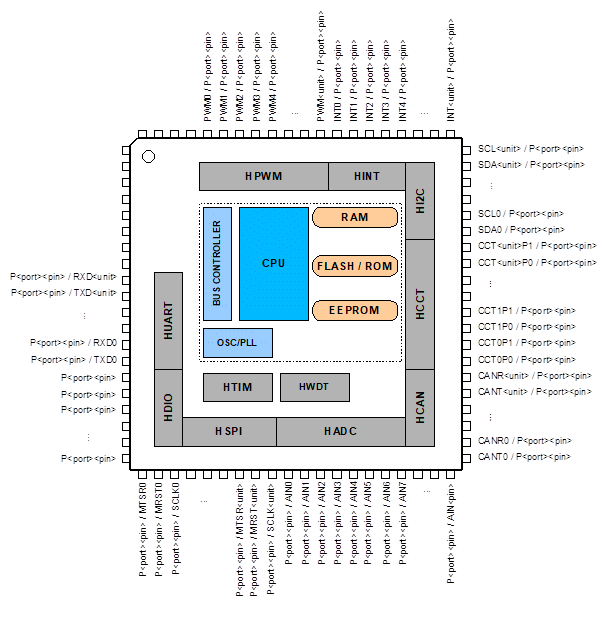

# HAL - Hardware Abstraction Layer

## 1. Introduction

The HAL (Hardware Abstraction Layer) provides the abstraction of the peripherals
of all populated microcontrollers.
It shall reduce an effort for the implementation of software products. This can
be achieved since the HAL reduces the effort to migrate the microcontroller
in products. Furthermore the HAL can be reused in different products.
Additionally the HAL allows to reuse of application software in products.
The development of the application software will be easier, since a functionality
and a behavior is unified through different microcontrollers as far as possible
in the HAL.

## 2. HAL Overview

The HAL provides virtual peripherals – HAL functions like "capture/compare’s HCCT"
are based on the main common features and requirements of the application for
different products. This HAL functions will be used by an application.
The following figure shall illustrate the embedding of the HAL into an application.

The HAL is mapped to the used microcontroller. From the HAL point of view
an application is not known. Here the microcontroller peripherals are mapped to the HAL functions like HPWM. It is defined on which peripheral a HAL function shall be
able to perform its task. Overlapping of the assigned peripherals between
HAL functions is possible.

Since each product has different requirements, a mapping from the application
to the HAL is performed by configuration. Here the assignment of the resources
of the HAL functions to the application is established. This fixes also the pinout
of the microcontroller in an application.

The following figure shows the microcontroller resources from an application
point of view. For the application a kind of virtual peripheral microcontroller
is used. The peripherals are represented by the HAL functions.
Contents and features of the virtual peripheral microcontroller are based on
the resources provided by the underlying microcontroller.

Since some microcontrollers have special peripherals or in case the HAL function
does not meet the requirements of an application, a bypass is defined. The bypass
allows the application function to access the microcontroller peripherals directly.

## 3. HAL Features
The following list summarizes the features provided by the HAL:
* The HAL provides functionalities which cover the requirements of different
products as far as possible from a peripheral point of view.
* The peripherals which are not used by HAL can be used by the application
directly if required.
* The interface and the behavior of the HAL is stable across all supported
microcontroller platforms.
* The HAL is delivered as a library.
* The HAL provides methods to configure the application to the product needs
during runtime.
* The HAL supports the family concept. The same code basis of the HAL shall
be used for the implementation in a microcontroller family. An external
configuration is provided to cope with specialties of family members.
* The HAL contributes to the development of processor peripheral independent
application software.

## 4. HAL Implementation

The implementation of each HAL function shall provide the following mandatory following parts:
* Source code files containing the implementation
* Header file containing the interfaces
* Configuration templates
* Function documentation

The following table lists all available HAL functions and its assigned abbreviations.

|HAL Function Abbreviation| Description|
|---|---|
|HADC|	digital conversion of analog input ports|
|HCCT|	capture / compare units|
|HDIO|	discrete input and output|
|HI2C|	I2C functionality|
|HINT|	interrupt capable input pins|
|HSPI|	serial peripheral interfaces|
|HUART|	UART functionality|
|HWDT|	watchdog functionality|
|HSUP| HAL support functions|

 

More information can be found in particular header files of each abstracted peripheral
located in `common/prog/MSP/<platform>` folder.

 
 

[Home page of help](../../../README.md)
