# Debug Component

## Introduction

The debug component allows users to send and receive string messages via a serial (UART) or an ITM (Instrumentation Trace Macrocell) interface. <br>
The configuration of this component is done using the [configuration file](../cfg_templates/debug_api_config.h). <br>
The debug component is not part of the generated system library, as it is not intended to be used in production software. <br>
In order to use the debug component, disable optimization (optim_level=0 in the build process). <br>

## Configuration Of The Debug Component 

This chapter discusses, how to redirect information printed by the debug component out of your controller and into the PC. <br>

### Microcontroller Side

On the controllers side, the debug component has several configuration options, 
all of which are provided in the [configuration file](../cfg_templates/debug_api_config.h). <br>

#### Choosing A Debugging Interface

Currently, the debug component is working with four different interfaces: <br>

- **STDIO**: Printing debug output to command prompt for Intel build is selected by defining DEBUG_INTERFACE_STDIO in [debug_api_config.h](../cfg_templates/debug_api_config.h).
- **ITM**: This interface is available only for microcontrollers with ARM Cortex-M3 and above and is selected by defining DEBUG_INTERFACE_ITM in [debug_api_config.h](../cfg_templates/debug_api_config.h).
- **RTT**: This interface is available for any Cortex-M microcontroller connected using SEGGER J-Link and is selected by defining DEBUG_INTERFACE_RTT in [debug_api_config.h](../cfg_templates/debug_api_config.h). Compared to ITM, RTT has such a benefit that it is not core clock speed dependent.
- **Serial (UART)**: This interface is selected by defining DEBUG_INTERFACE_SERIAL. The UART has to be configured to work properly:

   - For now, the debug interface supports the UART drivers in HAL, so that HAL has to be configured. MCAL is not supported for now.
   - Define BSP_HAL in [debug_api_config.h](../cfg_templates/debug_api_config.h).
   - Activate the UART by defining the according macro in your build process: HUARTx_USED, where x is the UART channel. For example: HUART2_USED
   - Configure the pin mapping in huart01xs.c, by setting the according macros in your build process, for example: HUART2_TX_PB10 HUART2_RX_PB11
   - Select the desired baudrate using the DEBUG_UART_BAUDRATE definition in [debug_api_config.h](../cfg_templates/debug_api_config.h).
   - Select the UART instance (same as 3 bullet points above) using the DEBUG_UART_CHANNEL definition in [debug_api_config.h](../cfg_templates/debug_api_config.h).
   - Before calling DBG_init to enable debug output/input, be sure to set the parameter DBG_UartCfgIndex to the correct value. It is the index indicating, which of the configurations in the array HUARTx_atConfig (where "x" is your UART channel) you would like to use. Choose an entry with a correct clock.
   - If you reclock your controller during operation, first call DBG_unInit. Next, set DBG_UartCfgIndex to a UART configuration with the new clock value, before calling DBG_init. This way your debug UART has been reclocked as well.
   - When calling DBG_init you automatically set the UART to no parity and one stop bit. (For now, users cannot choose these two settings.)

#### Configuration Of The Console Output

There are some configurations for the output style available: <br>

- DEBUG_ENDLINE_CR_LF - selects carriage return and line feed for each line ending.
- DEBUG_CONSOLE_PRETTY - switches colored output on (choose only if your teminal supports ANSI escape sequences).
- DEBUG_ECHO_ENABLE - enables echo - sending back received characters.

All these options can be defined in [debug_api_config.h](../cfg_templates/debug_api_config.h).

#### Retargeting Of System Calls

The debug component allows a retargeting of STDIO (printf, scanf) functions and of the assert failed function. To enable retargeting, the "retarget" component must be included in the build process and DEBUG_RETARGET_STDIO or DEBUG_RETARGET_ASSERT must be defined in [debug_api_config.h](../cfg_templates/debug_api_config.h). 
<br>

- DEBUG_RETARGET_STDIO - retargets STDIO printf and scanf functions to the debug interface. It also retargets all outputs from system calls (e.g. SIGABRT, or__aeabi_assert).
- DEBUG_RETARGET_ASSERT - retargets assert the failed system call to the debug interface.

### PC Side

As a debug console on the PC side, any serial monitor/console capable of sending and receiving ASCII characters via COM port may be used(e.g. PuTTY). 
(The default configuration of the serial interface is 115200 BAUD, 8N1.) 
If the serial monitor/console is capable of decoding ANSI escape sequences, the option DEBUG_CONSOLE_PRETTY can be used to output colored messages.

#### PuTTY (UART)

To use PuTTY as a debug console, the "Serial" radio button has to be checked in the "Session" tab and an appropriate COM port has to be selected. 
By default, PuTTY needs carriage return and line feed for line endings, which can be enabled by defining DEBUG_ENDLINE_CR_LF in 
[debug_api_config.h](../cfg_templates/debug_api_config.h) or by checking "Implicit CR on every LF" in the "Terminal" tab. <br>

PuTTY recognizes ANSI escape sequences, so DEBUG_CONSOLE_PRETTY can be enabled as well. <br>

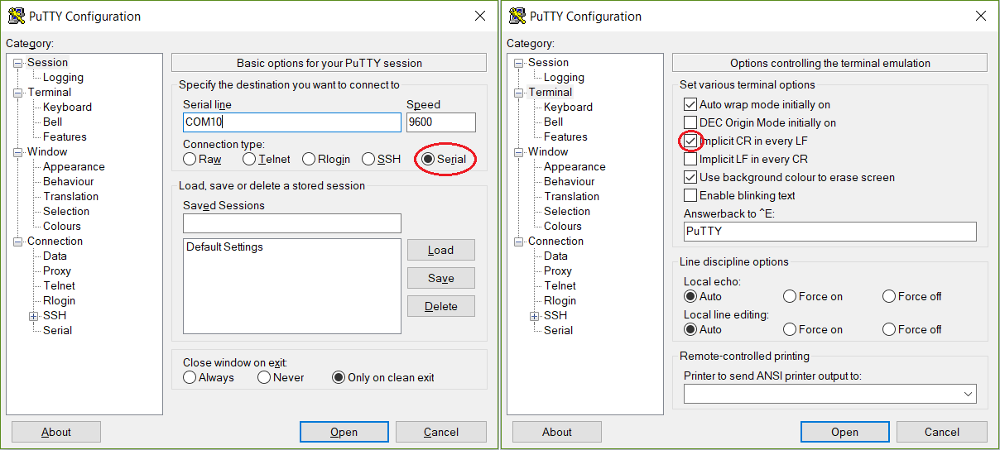

Putty sample output: <br>

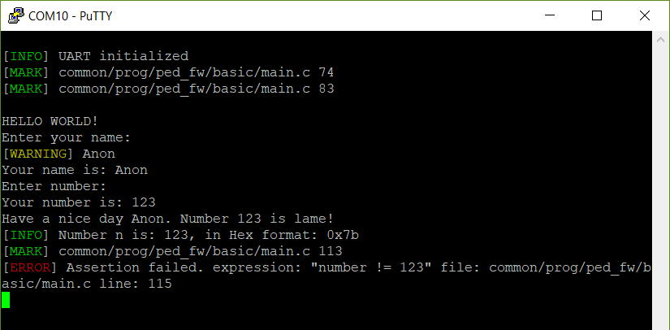

See to it, that the baud rate selected in PuTTY is the same as in [debug_api_config.h](../cfg_templates/debug_api_config.h). <br>
To minimize negative impacts on the performance of the software, it is recommended to use a high baud rate, at least 115200, 
which is suggested to the user in [debug_api_config.h](../cfg_templates/debug_api_config.h). <br>
You might even choose a value as high as 250000. It has been tested to work correctly and is good to minimize the impact on the software performance. <br>

#### Keil uVision (ITM) 

ITM can be used only for microcontrollers with ARM Cortex-M3 and above. To use ITM as a debug interface, trace needs to be enabled and configured. For trace to function properly, the Core Clock has to be set correctly. <br>
To achieve this, choose "Options for Target" in your Keil uVision project and go to the tab "Debug". 
On the right hand side of the chosen debugger (e.g. ST-Ling or ULINK) click "settings". Now you can set the core clock and enable trace: <br>

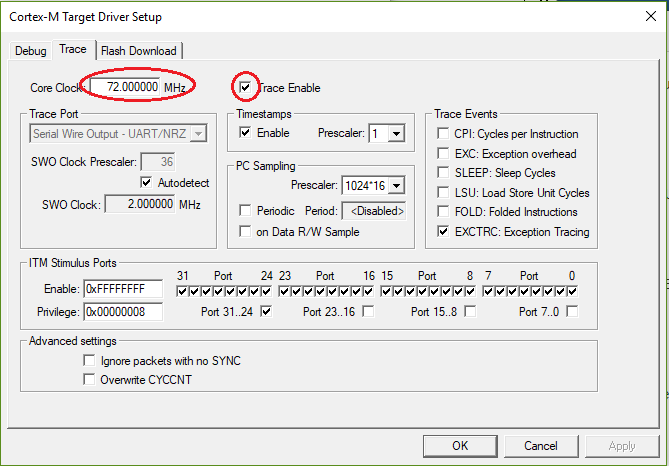

Click "Apply" and then "OK".<br>
In order to open the serial debug window, select "View -> Serial Windows -> Debug (printf) Viewer": <br>

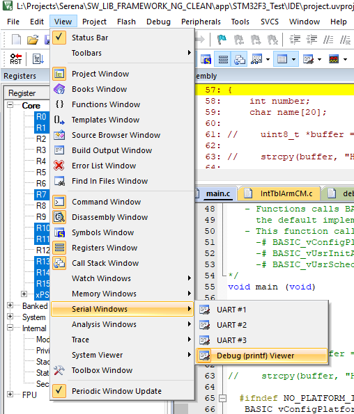

A typical debug output looks thus: <br>

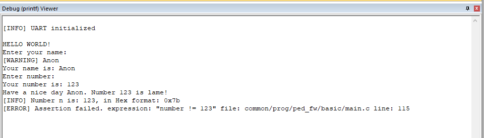

**NOTE: This method is only suitable, if you DO NOT reclock your microcontroller during runtime.** <br>

#### SEGGER Ozone (RTT) 

The RTT interface can be used only with SEGGER tools such as Ozone. To show a debug output in Ozone, it is sufficient to open a terminal window, no other configuration than the usual project setup is neccessary:<br>

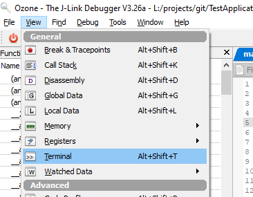

A possible output from the test application is shown in the picture below:<br>

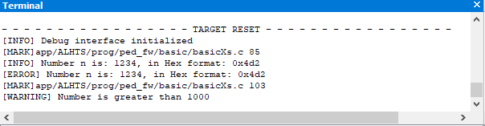

#### SEGGER JLinkRTTViewer (RTT) 

Another tool for displaying RTT outputs is the standalone JLinkRTTViewer application, that is provided along with other JLink tools:<br>

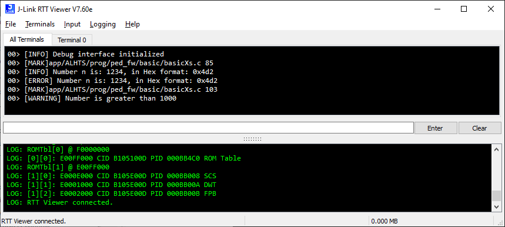

## Using The Debug Interface

This chapter provides some example code for the usage of the debug component and presents results to be expected. <br>

### Using The Debug Interface Functions

By means of the debug interface you can send debug messages, strings, or numbers. Debug messages consist of an info level, a string message and a line ending. <br>
The message level can be one of following: <br>

- DBG_INFO - informational message
- DBG_WARNING - non critical error
- DBG_ERROR - critical error (e.g. assert)
- DBG_MARK - informational mark message (for outputting file name and line number)

Custom messages can be composed by using the debug interface functions, or by using sprintf.

Example code: <br>

```
#include "debug/debug_api.h"
...
DBG_init();
 
/* Send info message and text */
DBG_writeMessage(DBG_INFO, "Debug interface initialized");
 
/* Send mark - file name and line number */
DBG_setMark();
 
int32_t n = 1234;
 
/* Custom debug message */
DBG_writeMessageLevel(DBG_INFO);
DBG_writeString("Number n is: ");
DBG_writeInt(n);
DBG_writeString(", in Hex format: ");
DBG_writeIntHex(n);
DBG_writeEndLine();
 
/* Alternative using sprintf */
char str[60];
sprintf(str, "Number n is: %d, in Hex format: 0x%x", n, n);
DBG_writeMessage(DBG_ERROR, str);
 
/* Send mark - file name and line number */
DBG_setMark();
 
if(n > 1000)
{
    DBG_writeMessage(DBG_WARNING, "Number is greater than 1000");
}
else
{
    DBG_writeMessage(DBG_INFO, "Number is lower than 1000");
}

```

The output will be following: <br>

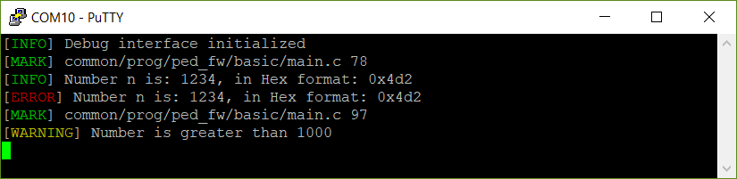

### Using The Debug Interface As An STDIO Console

For retargeting STDIO functions to the debug console, the component "retarget" has to be included into the build process, 
[see.](#retargeting-of-system-calls) <br>
Once you have done that, you will be able to use STDIO functions in the same way, as on a PC: <br>

```
#include <stdio.h>
#include "debug/debug_api.h"
...
DBG_init();
   
int32_t nIter;
printf("Enter number of iterations:");
scanf("%d", &nIter);
printf("\r\nYou entered: %d", nIter);
for(int32_t i = 1; i <= nIter; i++)
{
    printf("\r\nInteration number: %d", i);
}
printf("\r\nLoop finished!");
```

The output will be following: <br>

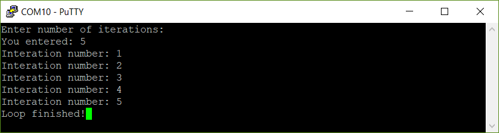

### Using The Debug Component For Assertions

For retargeting STDIO functions to the debug console, the component "retarget" has to be included into the build process, 
[see.](#retargeting-of-system-calls) <br>
Once you have done that, you will be able to use STDIO functions in the same way, as on a PC: <br>

```
#include <stdio.h>
#include <assert.h>
...
 
int32_t number;
printf("Enter number:");
scanf("%d", &number);
printf("\r\n");
 
assert(number != 123);
```

The output will be: <br>
When DEBUG_RETARGET_ASSERT and DEBUG_RETARGET_STDIO enabled: <br>

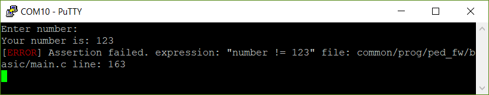

When DEBUG_RETARGET_ASSERT disabled and DEBUG_RETARGET_STDIO enabled (i.e. assert uses STDIO directly): <br>

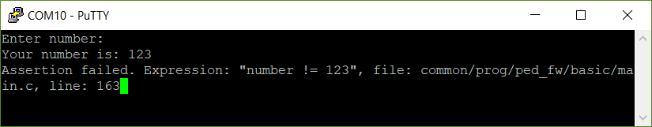

## Usage Of The Debug Component In Other Modules

[The debug commands of DBal use the debug component in order to compose debug messages.](../../dbus/DBal/BshDBus2AppLayer_debug.h)
