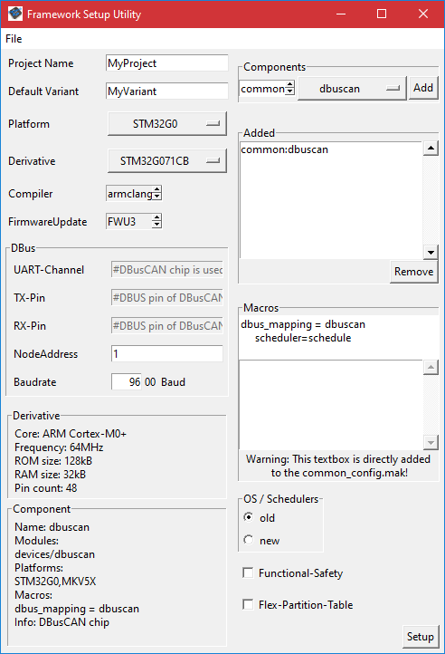

## DBusCAN chip
DBusCAN is an ASIC (Application-Specific Integrated Circuit) chip. Basically, it is both CAN FD and DBus controller with an integrated CAN FD and DBus transceivers. The DBus part of the DBusCAN chip replaces the data link layer of DBus-2.2 SW stack and thus provides robust hardware-based solution. For communication with a microcontroller the SPI interface and interrupt pin is provided.

More information about the DBusCAN chip specification and features can be found in the [datasheet](https://wiki.bsh-sdd.com/display/ASSA/DBusCAN+System+Basic+Chip?preview=/2607055673/3435946380/sllsfo1.pdf) and on the wiki page [DBusCAN System Basic Chip](https://wiki.bsh-sdd.com/display/ASSA/DBusCAN+System+Basic+Chip).

### Using DBusCAN chip in MCU Framework

To use DBusCAN chip in MCU Framework, you need to [set project via Setup Utility](https://wiki.bsh-sdd.com/display/PFS/How+to+Setup+project) with the dbuscan component added from the list of common components.

<newline>

After completing project setup, the Setup Utility automatically generates the definition of a make variable dbus_mapping to the "dbuscan" option into the common_config.mak file (in the section # global build settings): `dbus_mapping = dbuscan`

After completing project setup and build, there is a corresponding definition generated in variant header file `#define DBM_DBUSCAN` and also `#define DBUSCAN_INCLUDED`.

As long as the dbuscan component is used in the project, both the DBus and BP2 (Bootloader protocol) communication is transferred over the DBusCAN chip instead of the UART channel of the microcontroller (defined by the dbus_uart_channel make variable).

#### How to configure the DBusCAN chip
To configure basic settings and communication channels for the DBusCAN chip (MCAL libraries- MSPI and MEXTI are used), go to the file `app/<project>/prog/devices/dbuscan/<platform>/dbuscan_drv_cfg.c` and change predefined settings according to your project needs.

[Home page of help](../../../README.md)
