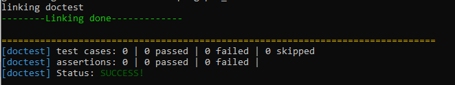
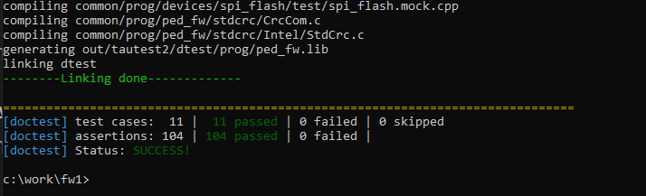

<div align="center">

<h1>Usage of Doctest inside the MCU Framework</h1>


</div>

# This document
This document is an overview and a quick start guide for using Doctest in the MCU Framework. For detailed information on Doctest please refer to the [Doctest-manual](doc/README.md). For more detailed information on the test strategy of MCU Framework and how to use doctest in the MCU Framework please refer to the [Test Strategy](doc/strategy/test_strategy.md).
Doctest does not provide mocking, but the MCU Framework provides a seamless integration of trompeloeil. For detailed information on trompeloeil please refer to the [Trompeloeil-manual](../trompeloeil/README.md).

# Why using Doctest

Doctest has been integrated into the MCU Framework to create off-target unit tests. Doctest creates meaningful test reports and is easy to use. As no cross-compiling or flashing is needed, it gives fast feedback; an additional test case can be compiled and executed in a few seconds. Doctest also allows unit tests to be organized using TEST_SUITE(), TEST_CASE(), and SUBCASE(). Doctest does not provide mocking, but the MCU Framework provides a seamless integration of trompeloeil.


# Limitations
Doctest uses resources which are usually not available on embedded systems with simple MCUs and it needs more RAM and ROM than provided by most MCUs. If tests are related to the hardware the unit test framework Tau might be used for on-target testing. But before creating on-target unit tests using tau please consider to mock the hardware using trompeloeil, as using off-target test is much more convenient. An according example for spi_flash has been implemented.

# Write first unit test for the application part or external component
## 1.  Build and run doctest:
```cmd
make variant=doctest
```



## 2. Add the component you like to test to file doctest.mak
```makefile
# file app/<project>/build/doctest.mak
# add your application specific components here
app_components = myComponent

# external components
ext_components = myExtComponent
```
## 3. Adapt the build.mak of the component you like to test
Units with unit test shall be added to build process by adding them to _ut_src_ instead of _src_
```makefile
# unit with according unit test files: myComponent/test/build.mak
ut_src += myComponent/myUnit.c
```

## 4. Create the unit test file myComponent/test/myUnit.dtest.cpp:
```c
//file: myComponent/test/myUnit.dtest.cpp
#include "myComponent/myUnit.c" // also the header myUnit.h might be included instead
#include <doctest/doctest.h>

TEST_SUITE("myComponent unit test")
{
    const uint32_t aValueAvailableInAllTests = 0x6;
    TEST_CASE("Test the interface mulValues")
    {
        initMyTest(); // optional stuff executed before each SUBCASE
    
        SUBCASE("do the first test")
        {
            CHECK(mulValues(aValueAvailableInAllTests, 7u) == 42u);
        }
    }
}
```

## 5.  Re-Build and run doctest:
```cmd
make variant=doctest
```


# Write first unit test for common components
## 1. Build und run the first unit test
To build the common doctest unit tests:
```cmd
make variant=dtest
```


## 2. Adding additional component for testing
In this example math is added to test build
```makefile
# file: common/build/variants/dtest.mak
ut_common_tests  += ped_fw/stdcrc math
```

## 3. Modify the component build file
Instead appending to the make variable *lib_src*, you need to append to *ut_lib_src*. In this case the according test math/test/mathDiv.dtest.cpp will be compiled in case of test build.
```makefile
# file: common/prog/math/build.mak
# in case of tau test math/test/mathDiv.dtest.cpp will be compiled
ut_lib_src += math/mathDiv.c
```

## 4. Write the first test for a selected unit
The test implementation includes the implementation of the unit under test, this also allows the test of static functions.
```c
//file: math/test/mathDiv.dtest.cpp
#include <doctest/doctest.h>
#include "math/mathDiv.c"

// define the operator '==' for the struct MTDIV_Result
bool operator==(const MTDIV_Result& lhs, const MTDIV_Result& rhs)
{
    return ((lhs.quotient == rhs.quotient) && (lhs.remainder == rhs.remainder));
}

TEST_SUITE("mathDiv")
{
    TEST_CASE("try any values")
    {
        CHECK(MTDIV_div_mod(43,6) == (MTDIV_Result){7,1});
    }
    TEST_CASE("dividend is zero") 
    {
        CHECK(MTDIV_div_mod(0,6) == (MTDIV_Result){0,0});
    }
    TEST_CASE("quotient is zero remainder not zero") 
    {
        CHECK(MTDIV_div_mod(5,6) == (MTDIV_Result){0,5});
    }
}
```
## 5.  Build and run doctest:
Trigger the test after any change:
```cmd
make variant=dtest
```