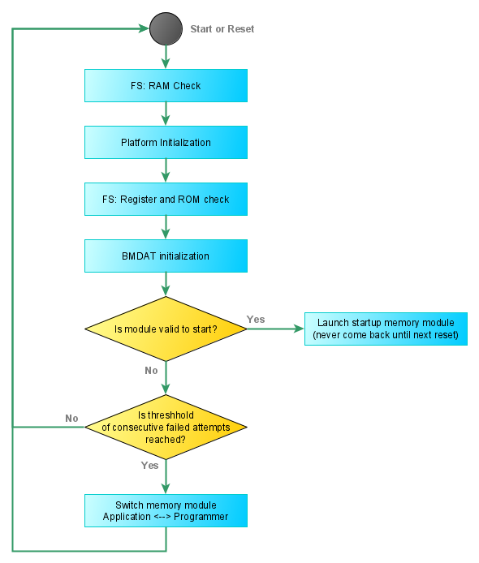

# BootManager General Documentation
---

### Content

1. [Abbreviations and Terms](#AbbreviationAndTerms)
2. [Introduction](#introduction)
    1. [Compatibility](#compatibility)
3. [BootManager Operation Overview](#BootmanagerOperationOverview)
    1. [One Time Functional Safety Check](#OneTimeFuntionalSafetyCheck)
    2. [Platform Initialization](#PlatformInitialization)
    3. [BM Shared Data Initialization](#BMsharedDataInitialization)
    4. [Module Validation Sequence](#ModuleValidationSequence)
    5. [Module Loading and Starting](#ModuleLoadingAndStarting)
    6. [Fragmented Applications](#FragmentedApplications)
    7. [Program Sequence Monitor](#ProgramSequenceMonitor)
4. [Borderline Situations](#BorderlineSituations) (Cases)
5. [Memory Structure](#MemoryStructure)
    1. [Data Structures in Flash](#DataStructuresInFlash)
    2. [Data Structures in RAM](#DataStructuresInRam)
6. [Usage Limitations of Optional Features](#UsageLimitationsOfOptionalFeatures)

 
 
 
 

### Abbreviations and Terms

|Abbreviation or Term|Description|
|---|---|
|BM|Boot Manager variant/[application](#app)|
|BMDAT|BootManager Shared Data structure in RAM|
|CRC|Cyclic Redundancy Code|
|FWU|FirmWare Update|
|FW-ID|Firmware Identification|
|FS|Functional Safety |
|RFU or  FWU3|Remote Firmware Update or FWU3|
|WFU or  FWU1|Wired Firmware Update (a.k.a. Local Firmware Update - LFU)|
|LRO|Loadable ROMLoader - built-in application that is used to perform WFU|
|LTS|Long Term Support. For more information please check [LTS Policy page](https://wiki.bsh-sdd.com/display/PFS/Long+Term+Support+Policy)|
|MAL|Memory Abstraction Layer|
|MAL PAT|MAL partition table (usually Fixed PAT)|
|OTP|One Time Programmable - Area in Flash memory where data can only be written once. In the case of MCU Framework, it is typically used to store Production Data|
|ROM|Read Only Memory|
|RAM|Random Access Memory|
|HW-ID|Hardware Identification|
|MCU| a Microcontroller used in electronics|
|MCU Framework |Microcontroller Framework|
|application| a FWU3 memory module that contains executable code|
|Application|a main product application - it is startable (executable attribute is set)|
|Programmer| built-in application that is used to perform RFU.|
|FWU memory module| FWU3 element defined in [MAL PAT](#malpat),  - it must contain [SW module header](#swmodheader) - it might contain executable code ([application](#app)) or it might contain only data (data memory module) - modules may have a dependency|
|startup memory module|executable [memory modules](#memmodule), that is supposed to be launched after reset (by BM)|
|built-in application| it is non updateable [application](#app) defined by MCU Framework|

[Back to content](#content)

## **1. Introduction** 

BM is a FWU application launcher, which is started immediately after microcontroller reset. Its main purpose is to launch one of the other available FWU3 applications: the [Programmer](#programmer), the Loadable RomLoader (LRO) or [Application](#prodapp)(s).

BM has replaced MiniLoader, which was used in the past for the same purpose. The main motivation for this replacement was to provide solution, that is simpler and easier to maintain, includes Functional Safety checks and which supports compatibility checks. To fulfill these requirements, it was necessary to introduce new FWU3 memory layout containing new shared data structures and to implement interfaces to access them in a convenient and secure way.

[Back to content](#content)

## **1.1 Compatibility** 

Compatibility between BM and updateable application is only guaranteed, when both were generated in versions that belong to the same LTS branch of MCU Framework. For example, BM generated on MCU Framework v1.3.1 is compatible with application based on v1.3.5 or v1.3.11, because all these versions belong to LTS_1.3 branch. However, compatibility with versions v1.4.0 or v1.7.8 is not guaranteed, as these do not belong to LTS_1.3 branch.

More info in https://wiki.bsh-sdd.com/display/PFS/Long+Term+Support+Policy
 

[Back to content](#content)

## **2. BootManager Operation Overview** 

After MCU reset, and before BM starts, the FS one time checks are performed and platform specific initialization (mainly clocks initialization) is done. Afterwards, the BMDAT is initialized if expected magic pattern in the BMDAT is not found (after hard reset).

In next step, BM checks whether startup memory module (specified in the BMDAT) is valid to start. If so, then the module is started. Otherwise software reset is generated and whole process is repeated. If specified FWU3 module is not started repeatedly (consecutive failed attempts threshold is reached), then different FWU3 module is selected to be started.

This concept ensures that the system does not get stuck trying to start a corrupted module in an endless loop. Instead, BM will try to start the [Programmer](#programmer), which is able to remotely re-flash and repair such corrupted application module.

[Back to content](#content)

## **2.1 One Time Functional Safety Check** 

BM performs the One time FS check in two steps:

First step - RAM check is performed immediately after the reset, before the [platform initialization](#PlatformInitialization). In the case of software reset, BMDAT structure is omitted from the RAM check to preserve necessary information. 
*NOTE: One Time Functional Safety RAM check destroys all content of the RAM when it is executed after HW reset.*

Second step - consists of CPU Core register check and ROM CRC check. Both checks are performed after the platform initialization, during initialization of BM. Only BM area is checked during this ROM CRC check.

There are no continuous FS checks in BM.

*Note: Additionally, BM performs ROM CRC check of the module that is going to be started as a part of executable [module validation sequence](#ModuleValidationSequence) (chapter 2.4, point 4).*

[Back to content](#content)

## **2.2 Platform Initialization** 

Platform initialization in BM contains clocks tree configuration and possibly also some other necessary initializations (e.g. Flash access wait states) depending on micro-controller platform. Additionally, it is possible to include project-specific initializations here. This may be helpful, for example when it is necessary to initialize some HW components immediately after appliance start.

Platform initialization is implemented in *basicMcXs.c* file. In MCU Framework, this file is used not only by [Application](#prodapp), but also by FWU3 built-in applications - Programmer and BM. Therefore care must be taken when adapting this file - even supposedly harmless addition may inflate BM code size so that it may exceed its reserved space. Good practice is to use **preprocessor directives** to sort out BM relevant and irrelevant parts.

[Back to content](#content)

## **2.3 BM Shared Data Initialization** 

BMDAT structure is located in the uninitialized data area in RAM a.k.a FWU_SHARED_DATA area. Therefore, if BM is able to find a valid magic pattern inside this structure, this is considered as an indication of previous SW reset and BM can directly proceed to the next step –  [module validation sequence](#ModuleValidationSequence).

However, if BM does not find valid magic pattern, BM considers that as an indication  of previous HW reset and in that case BMDAT structure is filled with initial values before proceeding to the next step.

[Back to content](#content)

## **2.4 Module Validation Sequence** 

The sequence has four main steps:
1. Initialization of [startup memory module](#startmemmodule) specified by ModuleId in BMDAT structure. If the initialization of startup memory module fails, then BM will set error flag in BMDAT structure: BMDAT_ER_BOOT_MODULE. 

2. Checking whether startup memory module is executable - BM checks if  corresponding MAL_CTX_MF_EXECUTABLE attribute is set. If not, then boot attempt is aborted and BM will set error flag in BMDAT structure:  BMDAT_ER_UNSTARTABLE. 

3. Checking integrity of startup memory module. If this is a built-in module, then only this particular module is covered and only integrity check itself is performed (CRC over the memory module). If this is updateable module, then all updateable modules are covered and not only the startup memory module. Moreover, consistency check is also performed (fragmented and dependent modules should have the same SW build ID). The only exception are modules that are located outside internal flash or have attribute MAL_CTF_MF_NO_INTEGRIY_CHECK set. Such modules are excluded from these checks.
If integrity is not OK, BM will set error flag in BMDAT structure: BMDAT_ER_INTEGRITY.

*NOTE: During check of integrity the watchdog is triggered because this step might take some time.* *NOTE: checking integrity can be disabled or error can be ignored by setting FWU Option Bytes - only for debugging purposes.*

4. Firmware ID validation of startup memory module (optional) - BM checks if FW ID of startup memory module matches with item in FWID table (only if stored in FWU OTP area). More information can be found in [Firmware Compatibility Check](../../doc/Firmware_Compatibility_Check.md) page. If Firmware ID validation fails, then BM will set error flag in BMDAT structure: BMDAT_ER_FW_ID.

*NOTE: All statements are valid for MAL Fixed PAT. The sequence is nearly the same for MAL Flexible PAT. Usage of MAL Flexible PAT feature is available only for experimental purposes. Security approval of the feature is pending*

[Back to content](#content)

## **2.5 Module Loading and Starting** 

BM launches the [startup memory module](#startmemmodule) when the validation process successfully passes.
The launch has two steps:
*  *The loading process*
*  *The starting process*

**The loading process** is applied only if specified execution address (in [SW module header](#swmodheader)) of the startup memory module differs from physical address (stored in corresponding PAT entry). This approach is typically used in case of the [Programmer](#programmer) (unless “low RAM” Programmer configuration is used).

**The starting process** stands for a simple jump to the startup memory module’s reset handler. There’s no SW reset between BM and the respective module. This is important to consider e.g. when initializing clocks in such module. Re-entrance of initializing routines must be ensured.

*Note: It is only possible to load modules into RAM.*

[Back to content](#content)

## **2.6 Fragmented Applications** 

Fragmented [Application](#prodapp) is an application that is split and allocated into non-continuous space in ROM. BM provides special support for such cases, to address functional safety requirements. When such application is going to be started, BM is able to perform ROM CRC check over all dependent fragments.

To make this possible, each fragment must have it’s own partition entry and a “chain” of dependent fragments must be created  in their respective partition entries (by setting dependent module ID into previous module's  dep_module value).

*NOTE: Only one fragment (per Application) can be executable - the one with the interrupt vector table.*

***IMPORTANT: Loading into RAM is not supported for fragmented Applications.***

[Back to content](#content)

## **2.7 Program Sequence Monitor** 

Unwanted execution of BM code (e.g. after invalid jump destination address or corrupted Program Counter) may in worst case lead to a jump from FS irrelevant to FS relevant code. To prevent this, BM contains Program Sequence Monitor - several evenly distributed test points that validate correct program flow. If incorrect program flow is detected, fatal error function is called. From this one, _FSF_vReportFatal() function is called, which can be adapted by user to define safety state.

[Back to content](#content)

## **3. Borderline Situations** 

**Corrupted Application:** If maximum number of attempts to start [Application](#prodapp) is exceeded (for example because it is corrupted after failed RFU), then BM  will try to launch the [Programmer](#programmer). If the Programmer is then successfully launched, it is possible to repair Application via RFU. This means that the Programmer has to be functional in all cases.

**Corrupted Programmer:** As it is not possible to remotely update the Programmer, it is unlikely that the Programmer will become corrupted. Theoretically it may happen in the case of physical Flash memory failure or failed WFU of the Programmer (by LRO). If this happens and there’s attempt to launch the Programmer, the BM's Module Validation Sequence will fail and BM will try to start Application instead. Nevertheless, Application will not be remotely updateable anymore unless the Programmer is repaired by successful WFU.

[Back to content](#content)

## **4. Memory Structures and organization** 

An overview can be found in [Memory organization](https://wiki.bsh-sdd.com/display/PFS/Memory+Organization) wiki page.

**MAL (Memory Abstraction Layer):** On top of low-level Flash access, MAL also defines shared FWU data structures in Flash memory and respective interfaces to access them. Both are tightly linked to BM functionality, therefore they are described in the next chapter.

[Back to content](#content)

## **4.1 Data Structures in Flash** 

**MAL_DataAnchor:** This structure contains pointers to MAL_partitionFix structure and also to MAL_partitionFlex structures (only if FWU_FLEX_PARTITION_USED). It has fixed position in the Flash memory (segment FWU_DATA_ANCHOR).

**MAL_FwuOptBytes:** This structure contains FirmWare Option bytes and it is located in special segment FWU_OPT_BYTES within Flash memory. User may use predefined keys - FWU option bytes - to disable evaluation of integrity check result or even to disable integrity check itself. This could be useful for development proposes. More information can be found in *common/prog/firmware_update/mal/fwu_opt_bytes.h* file.

**MAL_partitionFix:** By default, this structure contains partition entries for basic FWU modules: LRO, the [Programmer](#programmer), the [Application](#prodapp) and Flex PAT (only if enabled). More partition entries can be defined by project to allow additional project's memory modules. Fixed PAT cannot be remotely updated, including definition of each partition’s physical starting and ending address. Therefore it is important to specify sufficient size for each updateable partition (memory module) to be able to handle larger updates in the future.

**MAL_partitionFlex:** Unlike the former, this structure can be remotely updated. If it’s enabled in the particular project, it may be used to provide more flexible updates for the appliances in the field. There’s possibility to “overload” parameters of existing partitions stored in Fixed PAT, or even to specify additional partition entries to address more application modules. 
***IMPORTANT: MAL_partitionFlex feature is available only for experimental purposes. Security approval of the feature is pending.***

**SW Module Header:** At the very beginning of each FWU module (except the BM itself) there’s a SW Module Header structure *MDHD_ModuleHeader* that contains memory module properties additional to those already present in respective partition entry.
For example:
 * CRC of memory module area
 * pointer to interrupt vector table
 * size of memory module area
 * execution address - see also first paragraph in chapter [2.5](#ModuleLoadingAndStarting)
 * SW version structure

For more details see *app/prog/firmware_update/ModuleHeader.c*  file.

[Back to content](#content)

## **4.2 Data Structures in RAM** 

**BMDAT_sharedData:** This structure contains FWU related data, that are shared between different FWU modules and the BM itself, e.g.: error flags, start attempts counter, physical address of interrupt vector table and most importantly, the magic pattern that is used to recognize what was the reset cause. BM Shared Data is located in uninitialized data area (segment FWU_SHARED_DATA in RAM), therefore its content is not cleared when switching from one module to another (unless there’s a HW reset).

*Note: Make sure not to overwrite BMDAT content as that could make the transition between individual FWU applications impossible.*

BM provides dedicated BootManagerSharedData module (BMDAT) which contains public functions to allow unified access to this structure. It is part of BM itself and is also included in other FWU modules.

Please refer to chapter [2.3](#BMsharedDataInitialization) for more information about BM Shared Data initialization.

*Note: For more details about the memory structure, please check Linker Script file and address ranges in MSP/&lt;platform&gt;/Derivative.mak.*

[Back to content](#content)

## **5. Usage Limitations of Optional Features**  

**Flex PAT:** This feature still has to be reviewed from the security perspective and from the backend architecture perspective. Therefore usage of this feature is only allowed for experimental purposes.

[Back to content](#content)

  
[Home page of help](../../../../README.md)
