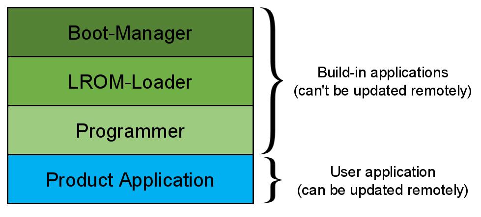
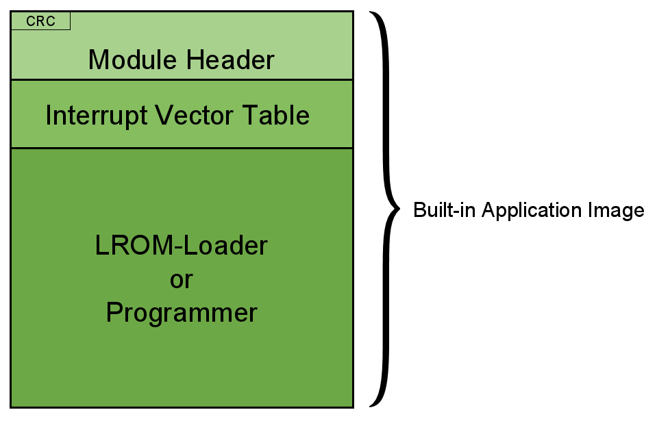
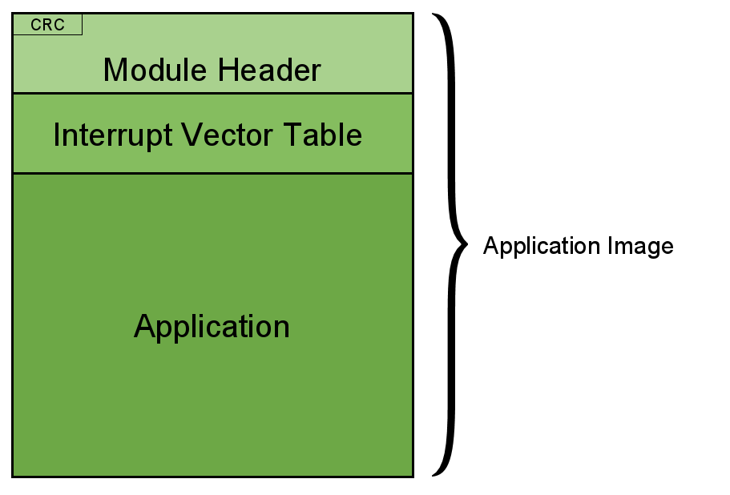
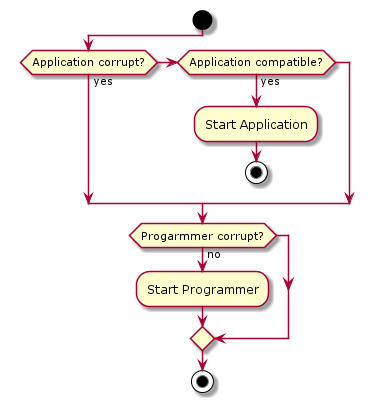
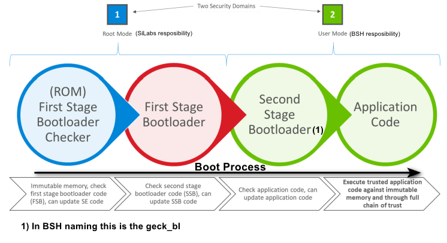
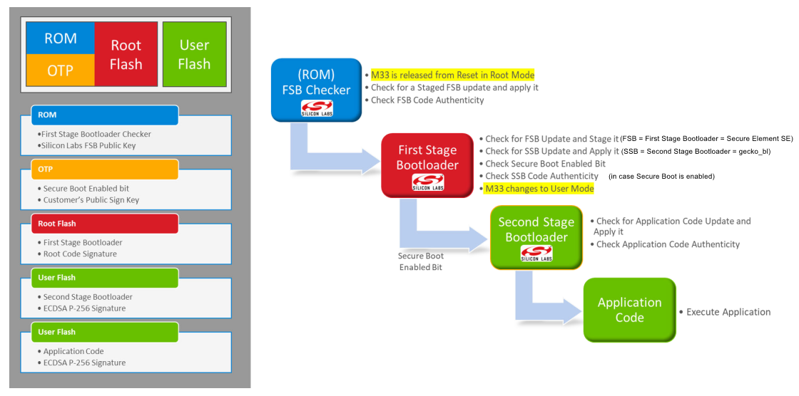
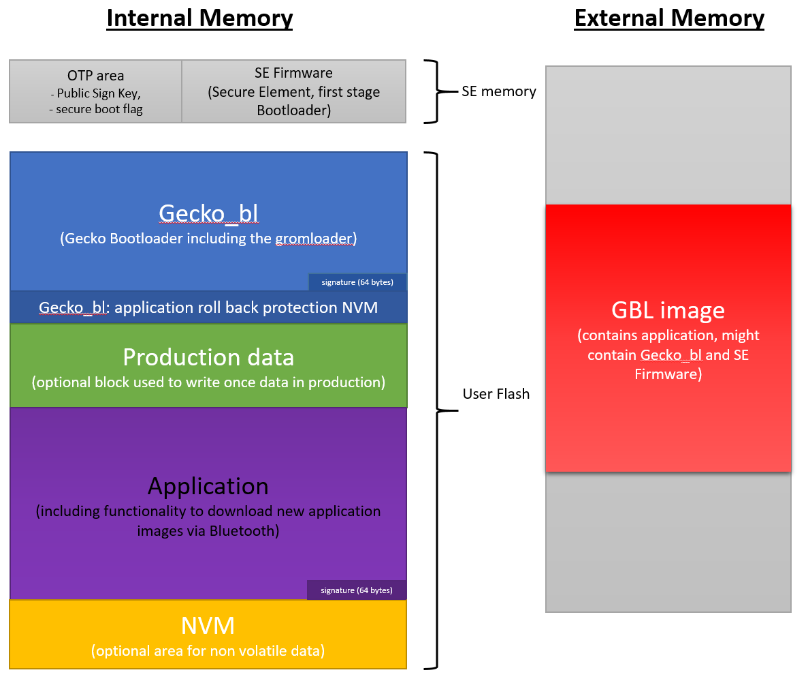
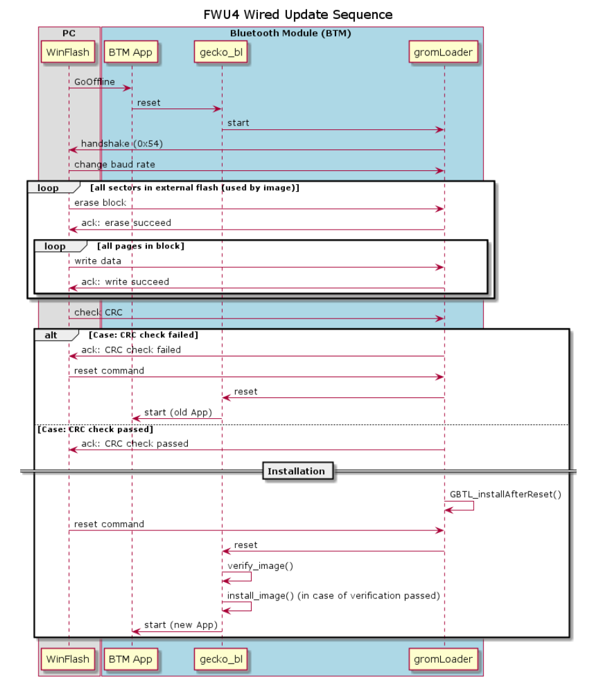
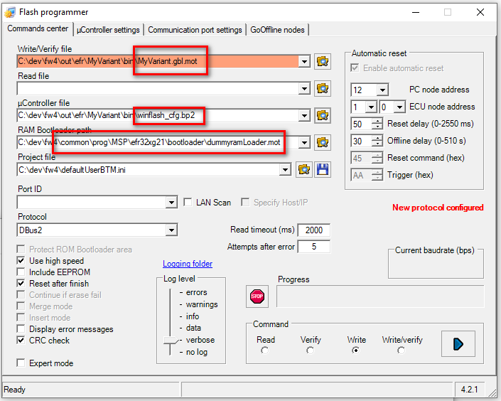

# Firmware Update
The MCU Framework provides three different types of firmware update.
- Remote Firmware Update (RFU or FWU3)
- Wired Firmware Update (WFU or FWU1) (a.k.a. Local Firmware Update - LFU)
- BT Firmware Update (BTFU or FWU4)

**Note:** It is recommended to generates the doxygen documentation which contains all interfaces, data and structure descriptions: `make project=<MyProject> doxy`.
The resulting documentation can be found in **`out/[<MyProject>/]<MyVariant>/doxy/<MyVariant>.chm`**.

# 1 Remote Firmware Update

## 1.1 Abstract
Remote Firmware Update (RFU) has been introduced to update the firmware via remote after the appliance has been delivered to the end customer.
It shall never happen that a remote update destroys an ECU. If a customer does switch off the appliance or there is a power loss during update,
the appliance shall be able to recover the update.

## 1.2 Build-in Applications
There are these build-in applications which are provided when remote update has been enabled:
- [Boot-Manager](BootManager/doc/bootmanager.md)
- Programmer
- LROM-Loader (LRO)
- RAM-Loader

### 1.2.1 Memory Map for RFU


### 1.2.2 [Boot-Manager](BootManager/doc/bootmanager.md)
The [Boot-Manager](BootManager/doc/bootmanager.md) (BM) becomes active directly after reset as the reset vector points to this application.
Part of the BM also is the partition table (PT). The PT defines a partition for each application.
By default after setup, there are partitions for the following start-able applications:
- LRO
- Programmer
- Application (updatable)

Additionally there might be application specific partitions e.g. for process parameters.

The main task of the BM is to start an application after reset. Usually this is the product application.
When an update process has been activated by an according request either the programmer or LRO will be started after reset.
Before starting an application the BM checks the CRC and [Firmware compatibility](doc/Firmware_Compatibility_Check.md) of the application. If there is anything wrong the programmer will be started instead.

### 1.2.3 Programmer
The programmer is the communication partner for the System Master (SM) after the update has been initiated.
In first step a memory module (which has en entry in the PT) will be opened by an according message for writing.
Then the opened memory module will be erased and step by step, message by message filled with the content of the updating image.
A final CRC check will be done to confirm successful update. After the next reset the BM takes over and try to start the updated application

The programmer also provides services to get device info or for reading a memory module.


### 1.2.4 LROM-Loader (LRO)
The LRO stands for 'loadable ROM-Loader'. The ROM-Loader is described in the chapter **2 Wired Firmware Update (WFU)**. The difference between LRO to ROM-Loader is that the BM loads the LRO. A loadable application has an additional header the so called *Module Header*.

### 1.2.5 RAM-Loader
The RAM-Loader is described in the chapter **2 Wired Firmware Update (WFU)**. There are no differences to RFU.

## 1.3 Memory Map Loadable Built-in Applications
The LRO and Programmer are startable built-in applications. As they are not updatable the [Firmware Compatibility Check](doc/Firmware_Compatibility_Check.md) is not required.


## 1.4 Memory Map Product Application (updatable)


## 1.5 General Definitions and Data Structures

### 1.5.1 Partition
A partition is a continuous memory area with a defined start and end address.
**Note:** The partition table will be accessed from different applications.
The MCU Framework ensures, that for each application the partition table is linked to the same physical address.

#### 1.5.1.1 Structure of partition entry (moduleAdministration.h)

```c
struct MAL_partition_s
{
    union MAL_addressPtr    physical_start;  ///< physical start address
    union MAL_addressPtr    physical_end;    ///< physical start address
    enum  MAL_ModuleEnum    mod_number;      ///< module number    
    enum  MAL_DriverID_e    driver_id;       ///< driver identifier
    uint8_t                 mod_attributes;  ///< module attributes
    uint8_t                 mod_name[16];    ///< module name
    enum  MAL_ModuleEnum    dep_module;      ///< dependency module number
};
```

#### 1.5.1.2 Example of partition entry

```c
const struct MAL_partition_s MAL_partitionFix[MAL_FIX_PARTITION_ENTRIES] =
{
...
...
    // Application
    {
        .mod_name            = "Application",
        .physical_start      = {.addr = FWU_APP1_START_ADDRESS},
        .physical_end        = {.addr = FWU_APP1_END_ADDRESS},
        .mod_number          = MAL_PRODUCT_APP1,
        .driver_id           = MAL_IntFlashDriver,
        .mod_attributes      = MAL_CTX_MF_RWEX,
        .dep_module          = MAL_NO_MODULE
    }
```

If you need to implement your own project specific partition, please follow the chapter
[How-to Add a partition](#32-how-to-add-a-partition)

#### mod_name
The module name is the name of the memory module which will be placed in the partition.
It shall not contain any special character or space and shall not start with a number. A maximum length of the module name is 16 characters.

#### mod_number
This is a ECU-wide unique module number.
The module identifiers are defined in *`app/[<MyProject>/]prog/firmware_update/mal/module_administration_cfg.h`*

```c
enum MAL_ModuleEnum
{
    MAL_PARTITION_TABLE = 0x5500u ///< Fixed: Module id for partition table
   ,MAL_PROGRAMMER_ID   = 0x5510u ///< Fixed: Module id for programmer
   ,MAL_BP2_LOADER_ID   = 0x5520u ///< Fixed: Module id for bp2 loader

   ,MAL_PRODUCT_APP1    = 0x2200u ///< Module id of product application1
   ,MAL_PRODUCT_APP2    = 0x2210u ///< Module id of product application2
   ,MAL_FLEX_PARTITION  = 0x22F0u ///< Module id of flex partition table
   ,MAL_NO_MODULE       = 0xFFFFu ///< Fixed: no valid module, used as last entry in flex table
};
```

#### driver_id
This is the identifier of the memory driver for the according partition.
Usually this is **MAL_IntFlashDriver**. The available driver identifiers are defined in *common/prog/firmware_update/mal/mal_driver.h*
When there is e.g. an external SPI-Flash a project specific driver might be implemented with the ID: *MAL_SpiFlashDriver*.

```c
enum MAL_DriverID_e
{
    MAL_NoDriver
   ,MAL_IntFlashDriver
   ,MAL_OptFlashDriver
   ,MAL_DataFlashDriver
   ,MAL_SpiFlashDriver
   ,MAL_EepromDriver
/* define your project specific driver here */
/* ,MAL_myExternalMemDriver */

};
```
If you need to implement your own memory driver, you need to define a few interfaces. Please read [How-to: Implement memory driver](#How-to:-Implement-memory-driver)


#### mod_attributes
This structure member defines the attributes according to the partition table entry.
For project specific partition this is one of *MAL_CTX_MF_RWEX* (read, write, erase, execute), *MAL_CTX_MF_RWE* (read, write, erase). If required to do not proceed a compatibility check for certain partition, then bit-field `MAL_CTX_MF_NO_COMPATIBILITY_CHECK` can be combined with *MAL_CTX_MF_RWE*.

```c
#define MAL_CTX_MF_READ_BLOCK               0x01U ///< read attribute
#define MAL_CTX_MF_WRITE                    0x02U ///< write attribute
#define MAL_CTX_MF_ERASE                    0x04U ///< erase attribute
#define MAL_CTX_MF_EXECUTABLE_EXT           0x08U ///< extension/fragment of an executable
#define MAL_CTX_MF_EXECUTABLE               0x10U ///< executable context
#define MAL_CTX_MF_NO_INTEGRITY_CHECK       0x20U ///< disable implicit integrity checking for modules in internal flash
#define MAL_CTX_MF_NO_COMPATIBILITY_CHECK   0x40U ///< disable compatibility checks between HW & SW
#define MAL_CTX_MF_WE           (uint8_t)(MAL_CTX_MF_WRITE | MAL_CTX_MF_ERASE)
#define MAL_CTX_MF_RWEX         (uint8_t)(MAL_CTX_MF_READ_BLOCK | MAL_CTX_MF_WRITE | MAL_CTX_MF_ERASE | MAL_CTX_MF_EXECUTABLE)
#define MAL_CTX_MF_RWEXX        (uint8_t)(MAL_CTX_MF_READ_BLOCK | MAL_CTX_MF_WRITE | MAL_CTX_MF_ERASE | MAL_CTX_MF_EXECUTABLE_EXT)
#define MAL_CTX_MF_RWE          (uint8_t)(MAL_CTX_MF_READ_BLOCK | MAL_CTX_MF_WRITE | MAL_CTX_MF_ERASE)
```

#### dep_module
This structure member defines the module ID of an dependent module. In most cases this would be *MAL_NO_MODULE*.
It is recommended not to use this feature, but sometimes a flash memory might be fragmented.
In this case there might be more than one partition to hold an application or data section.
Each fragmented partition has a main partition and one or more slave partitions.
The CRC (see Module Header) will be part of the main header only, the CRC of slave modules will be ignored.
To get one single CRC the calculation will be done section wise for each module.


## 1.6 Memory Module
A memory module (MM) is the intended content of a partition. It might be an application or data as well.
The attributes of a MM are described in the module header.

## 1.7 The Module Header
The Module Header (MH) describes the attributes of the MM.
 ```c
 struct MAL_ModuleHeader_s
{
    uint32_t       crc_expected;      ///< the crc value of the present module
    const MAL_isrPtr_t *ISRtbl_ptr;   ///< pointer to start of vector table
    uint32_t       size;              ///< number of bytes used by memory module incl. module header
    uint32_t       executionAddress;  /** Execution address for the module
                                          usually the physical start address of the module,
                                          in all other cases the memory module will be copied to its
                                          execution address before starting
                                       */
    struct FWU_sw_version_s sw_version; ///< present sw-version
    uint16_t reserved; ///< unused, currently used to enforce 4 byte alignment
    /** pointer to array of hardware identifiers (for which SW has been build) */
    const struct MAL_id_array_s *hw_id_array;
};
 ```


#### crc_expected
This is the very first address of a module. The entry holds the CRC of the module.
Usually this is a 32 Bit CRC, but for smaller MCUs this also might be a 16 Bit CRC.
The BM calculates CRC during its start and it compares against this CRC before starting an application.

#### ISRtbl_ptr
A pointer to the application interrupt vector table.
If the content is not an application or does not provide interrupts this item might be NULL.

#### size
This is the size of the memory module including its header.
The maximum possible size of a module is the size of its partition

#### executionAddress
Usually for MCUs this is the physical start address of the module.
In other cases the BM copies the content to the execution address and start
the image at this address.

**Hint**: For some platforms the programmer must be copied to RAM before starting it.

#### sw_version
The version string of the memory module.

 ```c
struct STDV_version
{
    uint8_t ID[STDV_ID_LENGTH];         ///< 8 character identifier
    uint8_t major[sizeof(uint16_t)];    ///< major changes e.g. new functionality, new interfaces
    uint8_t minor[sizeof(uint16_t)];    ///< minor changes, backwards compatible firmware
    uint8_t revision[sizeof(uint16_t)]; ///< revision (e.g. a fix)
    uint8_t build[sizeof(uint32_t)];    ///< software build counter or id from vcs
};
```

#### hw_id_array
This is a pointer to the array of hardware identifiers. Originally, it was used by the BootManager to verify compatibility of SW with particular HW variant (so called HW-ID check). In MCU Framework v1.9.x and higher, it is no more used and should be set to NULL. However, if BootManager from previous MCU Framework versions is used (v1.8.x and lower), then it should be pointing to actual hw_id_array structure.
In case of any questions, contact PED-support@bshg.com, please.

## 1.8 Shared Volatile Memory
To share information between the built-in applications and the product application, there is a Shared Volatile Memory area (SVM).
This SVM area is placed inside RAM, which is initialized after power-on reset only. A software reset will not modify this memory.
The MCU Framework makes sure, that each application links this area to the same address.

**Hint:** If you modify the linker script, please take care that you don't change the address of this region!

```c
struct BMDAT_sharedData_s
{
    size_t   IsrTableAddress;  ///< physical address of interrupt vector table
    uint32_t errorFlags;       ///< error flags
    enum MAL_ModuleEnum bootModule;  ///< identifier of module to boot
    uint16_t baudRate;         ///< start baud rate for boot loader
    uint16_t startAttempts;    ///< number of start attempts for boot manager
    uint16_t fatalErrorCounter;///< fatal error counter (used in case of functional safety error)
    enum BMDAT_magicPatterns magicPattern;     ///< holds a magic pattern to recognize uninitialized data
};
```


#### IsrTableAddress
Before starting an application the BM writes the address of the interrupt vector table to this structure entry.
As the interrupt vector table is part of an application it also must be saved in the same memory module.
Most supported MCU platforms provide a moveable interrupt vector table
Most platforms provide moving the interrupt vector table to other addresses.
If the MCU platform does not provide a moveable vector table, the BM implements an interrupt vector dispatcher.
For the MCU Framework this is the case for all CortexM0 derivatives.

#### errorFlags
This structure item holds possible errors occurred during start up process.

```c
enum BMDAT_errorFlags
{
    BMDAT_ER_NO_ERROR         = 0x00U,   ///< There is no error
    BMDAT_ER_BOOT_MODULE      = 0x01U,   ///< unsupported boot module
    BMDAT_ER_COMPRESSION_TYPE = 0x02U,   ///< unsupported compression type
    BMDAT_ER_CRC              = 0x04U,   ///< crc-check failed
    BMDAT_ER_UNSTARTABLE      = 0x10U,   ///< boot module not loadable
    BMDAT_ER_FW_ID            = 0x80U    ///< firmware id check failed
};
```

#### bootModule
This structure item tells the BM which application shall be started after a reset.
Usually this is the product application `MAL_PRODUCT_APP1`. In case of an update process starting it also might be the programmer or the LRO.
A so called GoOffline-Message which might be sent by the Flash-Programmer sets this attribute to `MAL_BP2_LOADER_ID`.
This cause the BM to start the LRO after reset.

The **Update Mode Transition Request** message, which might be sent by the SM, sets this attribute to `MAL_PROGRAMMER_ID`.
This cause the programmer will be started by BM after a reset.

For more details on the according DBus messages please refer the [DBus-Specification](../dbus/doc/D-Bus-2_2-PresentVersion.pdf)

```c
enum MAL_ModuleEnum
{
    MAL_PARTITION_TABLE = 0x5500u ///< Fixed: Module id for partition table
   ,MAL_PROGRAMMER_ID   = 0x5510u ///< Fixed: Module id for programmer
   ,MAL_BP2_LOADER_ID   = 0x5520u ///< Fixed: Module id for bp2 loader

   ,MAL_PRODUCT_APP1    = 0x2200u ///< Module id of product application1
   ,MAL_PRODUCT_APP2    = 0x2210u ///< Module id of product application2
   ,MAL_FLEX_PARTITION  = 0x22F0u ///< Module id of flex partition table
   ,MAL_NO_MODULE       = 0xFFFFu ///< Fixed: no valid module, used as last entry in flex table
};
```

#### baudRate
This is the start baud rate of the system after reset for programmer.

#### startAttempts
Number of BM's start attempts. If the application did not pass the start check,
this attribute will be incremented and the start check will be repeated.
After three attempts the programmer will be started instead of product application.
If the programmer is requested to start after three unsuccessful attempts the product application will be started.

#### fatalErrorCounter
Currently not used.

#### magicPattern
This structure item is needed to distinguish between a power on reset and a reset to enter another application.
The following enumeration shows the intended values for this structure item. For all other values a power on reset is supposed.
Values `BMDAT_startBlAfterReset` and `BMDAT_magicPattern` is intended for RFU only.

```c
enum BMDAT_magicPatterns
{
    BMDAT_startBlAfterReset     = 0x00U,
    BMDAT_longBootTimeOut       = 0x5A5A7979U,
    BMDAT_startAppAfterReset    = 0x55AA7799U,
    BMDAT_magicPattern          = 0x5A714B78U
};
```

## 1.9 [Boot-Manager](BootManager/doc/bootmanager.md) activity


### 1.9.1 The CRC Check (Application corrupt?)
The BM calculates the CRC and compares it against expected CRC. An application with wrong CRC is called corrupted application.

### 1.9.2 Compatibility (Application compatible?)
In this task the BM use the FW-ID to check if the application fits to the present HW / module configuration.
Compatibility check is deactivated until FW-ID is written into OTP memory.
For more information follow [Firmware Compatibility Check](doc/Firmware_Compatibility_Check.md)


# 2 Wired Firmware Update (WFU)
For WFU a unified FlashProgrammer is used to programme BSH ECUs via DBus interface.
For more details refer the [Boot-Loader-Specification](BootLoader/doc/BL_SPEC.pdf).

# 3 Bluetooth Firmware Update (BTFU)
## 3.1 Abstract
For the BTM the SiLabs secure update system has been combined with BSH wired firmware uptate (WFU).
An application image might be downloaded via WinFlash (BP2-Protocol on DBus hardware) or the application itself may do that via Bluetooth.
The image saved in the external memory is then installed by the Gecko-Bootloader (second stage Bootloader).
The same mechanism also allows to update the Gecko-Bootloader and the secure element (first stage Bootloader).
## 3.2 Boot Process 
The picture illustrates the chain of the boot process. The trust anchor is the "First stage Bootloader Checker". It is a ROM application and can never be modified.
This checker makes sure, that an authentic first stage Bootloader is present. SiLabs only is able to sign the first stage Bootloader.
The first stage Bootloader checks the second stage Bootloader (gecko_bl) and the second stage Bootloader finally checks the authenticity of the application.
The second stage Bootloader and the application is signed by BSH. Even when someone other than BSH will be able to download a software to the BTM,
the software will not be started as it is not correctly signed by BSH.

## 3.3 Secure Boot Flow
The following picture illustrates the secure boot flow. It also shows roughly how an update of FSB, SSB and application will be applied 

## 3.4 Memory Layout
There are 4 different memory types on BTM boards:
- internal user flash.
- internal OTP (this is part of the SE and cannot be accessed directly, it can be written once in production)
- internal SE Flash (it can be written in SE firmware (FSB) update only)
- external SPI Flash, here is the image located (GBL-file downloaded via WinFlash or BT-Application)


## 3.5 Wired Firmware Update inside FWU4
Like all other MCU platforms also the BTM need to be updatable via DBus hardware. This is a requirement form the customer service.
To reach security requirements for connected hardware, there is no RAM-Loader allowed.
No application can be downloaded and started inside RAM. Instead the ROM-Loader has the capability to write the image into external flash.
Direct writing to internal flash and RAM is not provided, for security reasons.
The ROM-Loader (gromloader) is not an independent application it is part of the gecko_bl.

Exactly like done for BT-Update the GBL-image will be verified and installed by the gecko_bl.



## 3.6 FWU4 FAQs

### A: How I can start an update via WinFlash?
The easiest way to start an update is typing in the following make command:
```
make flash
```
Instead you can also use the WinFlash GUI (common\tools\Flashprogrammer\WinFlash.exe), but it is not the recommanded way.


### B: How I can start an update including the Gecko_bl?
Te easiest way to start an update is typing in the following make command:
```
make flash bl_update=true
```
If you like to do it with the GUI you need to program the file `<MyVariant>_bl.gbl.mot`

### C: After enabling secure boot I cannot flash my device
After reset the CPU is not in user mode when secure boot is enabled.
That's why the device might not be flash-able with common tools (Jlink, µVision, Ozone,...) in this case.
There is a good workaround to solve this:
Open in console in your project root:
- **Step 1:** set a path to the SiLabs commander (make sure you have it on your system)
```
set path=%path%;M:\SwTools\SiLabs_commander\v1.12.0
```
- **Step 2:** start the commander with option --masserase and --halt. Make sure you have a connected JLink. The serial number of Jlink is optional. 
**Note:** for some reason the command usually need to be executed twice as first run terminates with an error message.
```
commander flash --masserase out\MyVariant\bin\MyVariant.hex --halt --device BGM210PA32JIA2 --serialno 504300308
```

# 4 How-tos

## 4.1 How-to Implement memory driver
### 4.1.1 Create new component for memory driver
- create a folder for your driver in the app folder, e.g.  **`app/[<MyProject>/]prog/ext_flash_drv`**
- copy the templates **`common/prog/firmware_update/cfg_templates/my_memory_drv.c and .h`** to your new component folder and rename them.
Take the hints out of the template for implementing the driver. There are differences between internal and external memory.
Especially the read function is not required for internal (address mapped) memory.
- select a meaningful component abbreviation for your driver.
**Note: The Driver is also used in the ramLoader, which has no startup. This means that when you are using static data you are responsible to initialize it!**

There are 2 principles for the architecture of the driver:
 - do as much as possible in the generic layers above
 - hide as much as possible the hardware e.g. how many bytes can be programmed in one step.
 
**Following the step-by-sep instruction how to implement and install the memory driver:**
- create a build.mak in the folder of the memory driver component. Usually just a single line is needed.
In our example this is:
```Makefile
src  += ext_flash_drv/ext_flash_drv.c
```
- add the new component to the application component list in the file **`app/[<MyProject>/]build/common_config.mak`**
usually the component is needed for ramLoader, programmer and BootManager only. Just in case when you don't need an integrity check of a memory module inside external memory, you should **not** add the component to Boot-Manager.
In this case you need to use the attribute MAL_CTX_MF_NO_INTEGRITY_CHECK in the according entry of partition table (refer chapter 3.2.5 Partition entry).
```Makefile
ifneq (,$(filter $(variant),programmer ramLoader))
    app_components += ext_flash_drv
endif
```

- each memory driver needs an enumerator in **`app/[<MyProject>/]prog/firmware_update/mal/module_administration_cfg.h`**
**Hint:** When you are writing an SPI flash driver you also can use the existing entry MAL_SpiFlashDriver.
```c
enum MAL_DriverID_e
{
    MAL_NoDriver
   ,MAL_IntFlashDriver
   ,MAL_OptFlashDriver
   ,MAL_DataFlashDriver
   ,MAL_SpiFlashDriver
   ,MAL_EepromDriver
/* define your project specific driver here */
   ,MAL_MyMemoryDriver
};
```
The added enumerator now might be used in the partition table. The programmer automatically will use the assigned memory driver.
The identifier also is needed in the definition of MEMDRV_driverTable.

- add new driver to driver table in file **`app/[<MyProject>/]prog/firmware_update/mem_drv_config.c`** to introduce the new driver to the ramLoader and programmer. **Please note:** If you need an integrity check of external memory module you need to add your driver also to the BootManager (else tree).
 
```c
#include "ext_flash_drv/ext_flash_drv.h"


#define MAL_MY_MEMORY_BP2_OFFSET 0xF000000 // offset address for boot loader
/******************************************************************************/
/* PUBLIC DATA DEFINITIONS                                                    */
/******************************************************************************/
const struct MEMDRV_driver_entry_s MEMDRV_driverTable[] =
{
/* --------------External memory drivers------------------- */
  #if defined(MAL_ENABLE_SPI_FLASH_DRIVER)
    {&DRVSF_driver, MAL_SpiFlashDriver, MAL_NO_BP2_OFFSET},
  #endif
  #if defined(MAL_ENABLE_EEPROM_DRIVER)
    {&DRVEE_driver, MAL_EepromDriver, MAL_NO_BP2_OFFSET},
  #endif
/* +++++++++ Add your external memory driver here +++++++++ */
 /* {DRVMD_driver, MAL_MyMemoryDriver, MAL_MY_MEMORY_BP2_OFFSET},  */
#ifndef VARIANT_BOOTMANAGER
/* --------------Internal memory drivers------------------- *
 * For internal memory boot manager does not need a driver, *
 * as just read-only access is needed                       *
 * -------------------------------------------------------- */
    {&DRVIF_driver, MAL_IntFlashDriver, MAL_NO_BP2_OFFSET},
  #if defined(MAL_ENABLE_OPT_FLASH_DRIVER)
    {&DRVOF_driver, MAL_OptFlashDriver, MAL_NO_BP2_OFFSET},
  #endif
  #if defined(MAL_ENABLE_DATA_FLASH_DRIVER)
    {&DRVDF_driver, MAL_DataFlashDriver, MAL_NO_BP2_OFFSET},
  #endif
  {NULL, MAL_NoDriver, MAL_NO_BP2_OFFSET} // do not remove end mark !!
#endif
};

```
For each driver three entries are needed. First the pointer to the driver itself, second the identifier of the driver
and third the offset address for wired firmware update.

**Note:** As the responsible memory driver for wired firmware update, can be identified by the address only,
each driver needs it's own unambiguous memory region. For external memory drivers therefore sometimes is an offset address required.
The offset is used for wired firmware update only. Usually for STM32 this is not required as internal flash
is not starting with the physical address zero.


## 4.2 How-to add a custom SW memory module

User can define additional SW memory modules, e.g. data memory module to store some data or parameters. In FWU3 project, the content of user's SW memory module can be remotely updatable.

Starting from MCU Framework version v1.9.0 we are using auto-generated file `fwu_mem_map.mak`. The file is generated by the make process at very beginning. In this file there are listed defined address ranges for all built-in and project specific SW memory modules as well as the corresponding defines for source code. Memory layout has a pre-defined order, however some modifications can be done by user's definitions.

Make definitions of SW module size, start and end address have following priority in .mak file include system:<br>
`common_config.mak` **>** `derivative.mak` **>** `specific_config.mak` **>** `fwu_mem_org.mak`<br>
If there are no user's modifications then the auto-generated file `fwu_mem_org.mak` contains default values.

Next chapter shows a typical use-case, how to add an additional remotely updateable SW memory module for process data. Other use-cases are described in chapters 3.3, 3.4, 3.5 and 3.6.

To add a project specific SW memory module following steps have to be done.

The example is made for CortexM platform using Keil or GCC linker.

### 4.2.1 Define and reserve memory for the desired SW memory module

Let's say we want to define a SW memory module named **`FWU_PROCESS_DATA`** of the size **800H** bytes. User can set other name for the SW data memory module.

To reserve a memory space for a SW memory module, following make definitions need to be added. We recommend to create a new file **`app/[<MyProject>/]build/specific_config.mak`** to be used for these definitions.


```Makefile
FWU_PROCESS_DATA_SIZE = 800
FWU_PROCESS_DATA += name=FWU_PROCESS_DATA size=0x$(FWU_PROCESS_DATA_SIZE)

# FWU_PROCESS_DATA module will be placed behind the application, therefore the application end address needs to be decreased
FWU_APP1_END_ADDRESS := $(call calcx,0x$(ROM1_PHY_END)-0x$(FWU_PROCESS_DATA_SIZE))

FWU_APP_MODULE_LIST += FWU_APP1
FWU_APP_MODULE_LIST += FWU_PROCESS_DATA

# patchbin options for FWU_PROCESS_DATA module
ifneq (,$(filter $(variant),$(app_variants)))
patchbin_opt_proj += -f(0x$(FWU_PROCESS_DATA_START_ADDRESS)+$(crc_offset),0x$(FWU_PROCESS_DATA_END_ADDRESS)):0xFF
patchbin_opt_proj += -CRC(0x$(FWU_PROCESS_DATA_START_ADDRESS)+$(crc_offset),0x$(FWU_PROCESS_DATA_END_ADDRESS))(0x$(FWU_PROCESS_DATA_START_ADDRESS)):$(crctype)
endif
```

Defines for both start and end addresses of the new SW memory module (in the example `FWU_PROCESS_DATA_START_ADDRESS` and `FWU_PROCESS_DATA_END_ADDRESS`) are created automatically. Users don't need to define them manually.

To patch the required CRC to the start address of SW memory module, there is set the make variable `patchbin_opt_proj` to be used later in the build process by the Patchbin tool.
See the full version of the file [specific_config.mak](doc/example_files/specific_config.mak_example1.md)

The `FWU_PROCESS_DATA` SW memory module is placed behind the project application `FWU_APP1` by defining the lines within the specific_config.mak file. See the example file of the auto-generated [**`app/[<MyProject>/build/fwu_mem_map.mak`**](doc/example_files/fwu_mem_map.mak_example1.md) file.


### 4.2.2 Add a linker script section

Definitions from auto-generated file **`app/[<MyProject>/build/fwu_mem_map.mak`** are used in the linker script template file.

#### 4.2.2.1 Keil linker script

If the Keil linker is used then users need to modify the template file of Keil linker script:<br>
**`app/[<MyProject>/]prog/MSP/<platform>/LinkerScript.sct.h`** .

The following load region (LR) has to be added:

```c
...
#ifdef APP_VARIANT
LR_FWU_PROCESS_DATA FWU_PROCESS_DATA_START_ADDRESS FWU_PROCESS_DATA_SIZE
{
    ER_FWU_PROCESS_DATA_SW_MODULE_HEADER +0
    {
        *(FWU_PROCESS_DATA_SW_MODULE_HEADER, +FIRST)
		*(FWU_PROCESS_DATA)
    }
}
#endif
...
```

**Note:** It is highly recommended to add your sections at the beginning of Keil linker script.
A common problem is that application RAM initializers might be placed in your section(s) when you don't follow this rule!!

#### 4.2.2.2 GCC linker script

If the GCC linker is used, the GCC linker script template file
**`app/[<MyProject>/]prog/MSP/<platform>/LinkerScript.ld.h`** needs to be modified.

Add the following entries to the memory area and the section area:

```c
...
MEMORY
{
...
#ifdef FWU_PROCESS_DATA_START_ADDRESS
  PROCESS_DATA_ROM    (rx) : ORIGIN = FWU_PROCESS_DATA_START_ADDRESS, LENGTH = FWU_PROCESS_DATA_SIZE
#endif
...
}

SECTIONS
{
...
#ifdef APP_VARIANT
#ifdef FWU_PROCESS_DATA_START_ADDRESS
    .process_data :
    {
        KEEP(*(.FWU_PROCESS_DATA_SW_MODULE_HEADER))
        KEEP(*(.FWU_PROCESS_DATA))
    } > PROCESS_DATA_ROM
#endif
#endif
...
}
```

These were just examples how linker script adaptation may look like for Keil or GCC linker. For details on linker script adaptation please refer to the manual of the linker used. 

### 4.2.3 Add a module ID of a new SW module

Each SW memory module, either built-in or project specific, needs an ECU-wide unique module-ID.
To add a module-ID for SW memory module named **`FWU_PROCESS_DATA`**, the file **`app/[<MyProject>/]prog/firmware_update/mal/module_administration_cfg.h`** needs to be adapted.

**Explanation: <br>Each SW memory module of FWU3 memory layout (except the BootManager) is represented by the entry in the Fixed partition table. In the build process, these are called built-in variants or built-in applications. The user's application is also a SW memory module (also known as the application variant) which has unique entry in the Fixed partition table.**

Therefore the Fixed partition table will have four entries: the LRO, the Programmer, the Application and the process data module.

```c
#define MAL_FIX_PARTITION_ENTRIES   4u ///< number of entries in fix partition table
#define MAL_FLEX_PARTITION_ENTRIES  0u ///< number of entries in flex partition table
#define MAL_HW_VERSION_ENTRIES      1u ///< number of entries in HW version table


enum MAL_ModuleEnum
{
    MAL_PARTITION_TABLE = 0x5500u ///< Fixed: Module id for partition table
   ,MAL_PROGRAMMER_ID   = 0x5510u ///< Fixed: Module id for programmer
   ,MAL_BP2_LOADER_ID   = 0x5520u ///< Fixed: Module id for bp2 loader

   ,MAL_PRODUCT_APP1    = 0x2200u ///< Module id of product application1
   ,MAL_PROCESS_DATA    = 0x2201u ///< Module id of process data partition
   ,MAL_FLEX_PARTITION  = 0x22F0u ///< Module id of flex partition table
   ,MAL_NO_MODULE       = 0xFFFFu ///< Fixed: no valid module, used as last entry in flex table
};
```

### 4.2.4 Add a partition entry of a new SW memory module into the fixed partition table

The partition entry of the FWU_PROCESS_DATA module needs to be added into the fixed partition table `MAL_partitionFix` which is located in the file **`app/[<MyProject>/]prog/firmware_update/mal/module_administration_cfg.c`**
**Note:** There might be also a flex partition table which might be remote updatable but this table is not recommended due to the complexity.

```c
SYMBOL_USED const struct MAL_partition_s MAL_partitionFix[MAL_FIX_PARTITION_ENTRIES] =
{
...
    // Application
    {
        .mod_name            = "Application",
        .physical_start      = {.addr = FWU_APP1_START_ADDRESS},
        .physical_end        = {.addr = FWU_APP1_END_ADDRESS},
        .mod_number          = MAL_PRODUCT_APP1,
        .driver_id           = MAL_IntFlashDriver,
        .mod_attributes      = MAL_CTX_MF_RWEX,
        .dep_module          = MAL_NO_MODULE
    },
    // Process Data
    {
        .mod_name            = "Process_Data", // no white space!!
        .physical_start      = {.addr = FWU_PROCESS_DATA_START_ADDRESS},
        .physical_end        = {.addr = FWU_PROCESS_DATA_END_ADDRESS},
        .mod_number          = MAL_PROCESS_DATA,
        .driver_id           = MAL_IntFlashDriver,
        .mod_attributes      = MAL_CTX_MF_RWE,
        .dep_module          = MAL_NO_MODULE
    },
...
```

### 4.2.5 Create a SW module header for a new SW memory module

There shall be created a compilation unit defining the SW memory module header for the new SW memory module.
For the new FWU_PROCESS_DATA module the proposed file name is: **app/[<MyProject>/]prog/ModuleHeaderProcessData.c**.

The SW memory module header is located at the start address of the memory module and it has to be placed to the user-defined segment. In the example it is named `FWU_PROCESS_DATA_SW_MODULE_HEADER`.

Example content of the file ModuleHeaderProcessData.c:
```c
...
SDEF_SetSegmentConst(FWU_PROCESS_DATA_SW_MODULE_HEADER)
static SYMBOL_USED const struct MAL_ModuleHeader_s MDHD_ModuleHeaderProcessData =
{
    .crc_expected = 0u,     // will be replaced by patchbin
    .ISRtbl_ptr   = NULL,   // unused
    .size         = FWU_PROCESS_DATA_SIZE,
    .executionAddress = 0u, // unused
    .sw_version =
    {
     .version =
        { /** \todo please specify id-string for your application */
            .ID       = {0,1,2,3,4,5,6,7},
            .major    = {0x12, 0x34},
            .minor    = {0x98, 0x76},
            .revision = {0xfe, 0xdc},
            .build    = {0xab, 0xcd, 0xef, 0x01}
        }
    },
    .reserved     = 0u,
    .hw_id_array  = NULL    // unused
};
SDEF_SetSegmentConst_Default()
```
See the full example of the file [ModuleHeaderProcessData.c](doc/example_files/ModuleHeaderProcessData.c_example1.md)

### 4.2.6 Add data to a new SW memory module

To place your data to the supposed data segment you need to use macros from the file **SegmentDef.h**.

```c
...
#include "SegmentDef.h"
#include "std_symbol.h"

SDEF_SetSegmentConst(FWU_PROCESS_DATA)
// place your data here
SYMBOL_USED const struct ...
...
SDEF_SetSegmentConst_Default()
```
See the example of the file with the module data: [process_data.c](doc/example_files/process_data.c_example1.md)

### 4.2.7 Extend ECU Config Read Response DBus message due to a new SW module

Due to the new SW module FWU_PROCESS_DATA, it is also required to modify the interface function `DBPL_tGetEcuConfigReadResult` of the DBus message "ECU Config Read Response" (messageID F511h, MSG_ECU_CONFIG_READ_RESPONSE) in the file
**`app/[<MyProject>/]prog/dbus/dbuspresentation_updateXS.c`**.

**NOTE1**:
Do not modify anything for the Programmer variant. It is not required for Programmer to access ECU Config Data from the user application and user data module.

**NOTE2**:
The current application running (either Programmer or user application) must have its object ID (`ProgrammerObjId` or `ApplicationObjId`) assigned to "1".

**Hint:** The symbol '>' marks lines which need to be changed or added.

```c
...
struct DBPL_EcuConfigReadResult DBPL_tGetEcuConfigReadResult(uchar objIdNumber)
{
...
#ifdef VARIANT_PROGRAMMER
    const uint8_t EcuConfigCount   = 1u; /* Programmer NOT updatable */
    const uint8_t ProgrammerObjId  = 1u;
    const uint8_t ApplicationObjId = 2u;
    obj.status = DBPL_EcuStatusUpdateModeActive; /*Programmer is running.*/
#else
>   const uint8_t EcuConfigCount   = 2u; /* Programmer NOT updatable, 2 user modules. */
>   const uint8_t ProgrammerObjId  = 3u;
    const uint8_t ApplicationObjId = 1u;
>   const uint8_t ProcessDataObjId = 2u;
    obj.status = DBPL_EcuStatusOK; /*Expected to be ok.*/
#endif
...
...
    if((objIdNumber > DBPL_UPDATE_ECU_CONFIG_UNSUPPORTED_OBJ_ID_NUMBER) && (objIdNumber <= EcuConfigCount))
    {
        if (objIdNumber == ApplicationObjId)
        {
            module_header = BMMOD_GetMemModuleHeader(MAL_PRODUCT_APP1);
        }
        else if (objIdNumber == ProgrammerObjId)
        {
            module_header = BMMOD_GetMemModuleHeader(MAL_PROGRAMMER_ID);
        }
>#ifndef VARIANT_PROGRAMMER
>       else if (objIdNumber == ProcessDataObjId)
>       {
>           module_header = BMMOD_GetMemModuleHeader(MAL_PROCESS_DATA);
>       }
>#endif // ifndef VARIANT_PROGRAMMER
        else
        {
            /* no action required */
        }

        hw_version = OTP_getHardwareVersion();
    }
...
}
```
Then, after sending the data "0xC002" in the DBus message "ECU Config Read Request" (message ID F510h) while the user application is running in ECU, the response DBus message "ECU Config Read Response" will return the information from SW Module Header of the user-defined SW memory module. In the example it is named as `FWU_PROCESS_DATA`.

## 4.3 How-to place custom SW memory module before the Application

In the previous chapter 3.2 (especially in chapter 3.2.1) have been described steps how to configure the SW memory module FWU_PROCESS_DATA. The module was placed behind the user application in a flash memory layout.
Now, we will show how the SW module FWU_PROCESS_DATA can be placed before the user application SW module. User SW memory modules will be in this order:<br>

* FWU_PROCESS_DATA
* FWU_APP1

Like in previous example, see the example code in the [specific_config.mak](doc/example_files/specific_config.mak_example2.md) example file for this configuration.

The auto-generated file fwu_mem_map.mak is different than the one from the previous example in the chapter 3.2. See the [fwu_mem_map.mak](doc/example_files/fwu_mem_map.mak_example2.md) file for this configuration. Notice the position and addresses of SW memory module `FWU_PROCESS_DATA` in the file.

The remaining configuration steps (including file modifications) that are described in chapter 3.2 must be done the same way. Namely modification of these files: LinkerScript.sct.h or LinkerScript.ld.h, module_administration_cfg.h, module_administration_cfg.c, ModuleHeaderProcessData.c, process_data.c, 
dbuspresentation_updateXS.c.

## 4.4 How-to move the virtual EEPROM area from default to a custom position

The virtual EEPROM area is a reserved memory space in the code flash. It can be enabled by adding the component NVMEM(virt) in the GUI setup utility or by adding the components `nvmem`, `veeprom` and `flash` manually. More info about using NVMEM component can be found in the related [README.md file](../ped_fw\nvmem\README.md).

By default, the virtual EEPROM area is placed between the `FWU_OTP_MEMORY` and `FWU_APP1` SW memory modules. See the example of the auto-generated file [fwu_mem_map.mak](doc/example_files/fwu_mem_map.mak_example3.md) when virtual EEPROM is enabled. 

If user needs to move the virtual EEPROM area `VIRTUAL_EEPROM` behind the Application area `FWU_APP1`, the order of SW modules will look like this:
   * FWU_BOOTMANAGER
   * FWU_LRO
   * FWU_PROGRAMMER
   * FWU_OTP_MEMORY
   * FWU_APP1
   * VIRTUAL_EEPROM
  
This can be achieved by creating a new file `specific_config.mak` in the folder `app/<MyProject>/build/` in which the make variable `FWU_APP_MODULE_LIST` is overloaded and the make variable `FWU_APP1` is overridden by specifying the size of application in other way like it is specified by default (with the FWU_APP1_END_ADDRESS).

```Make
override FWU_APP1 = name=FWU_APP1 size=0x17800
```

See the full version of the example file [specific_config.mak](doc/example_files/specific_config.mak_example4.md). You can also look at the example of the auto-generated file [fwu_mem_map.mak](doc/example_files/fwu_mem_map.mak_example4.md) when virtual EEPROM area is moved at the end of the flash memory. 

## 4.5 How-to adjust the application start address

Users can redefine the start address of the application SW memory module which is defined by the `FWU_APP1_START_ADDRESS` make variable.
Usually, the SW memory module `FWU_APP1` follows the `FWU_OTP_MEMORY` without any gaps. Then the order of SW memory modules will be the same, but there will be reserved space for user needs.
   * FWU_BOOTMANAGER
   * FWU_LRO
   * FWU_PROGRAMMER
   * FWU_OTP_MEMORY
   * Reserved space 
   * FWU_APP1

To adjust the `FWU_APP1_START_ADDRESS`, simply edit the file `app/build/common_config.mak` and add following lines below the comment `# global build settings`. This example uses STM32G0 specific start application address:

```Makefile
# global build settings
# moving the default start address 8006800H to new position: 8006800H + 1000H = 8007800H
FWU_APP1_START_ADDRESS = 8007800
```

The reserved space is 1000H (4kB) what is exactly the flash page size of used derivative.

**Please make sure that the new application start address is aligned to the flash page boundaries.**

Look at the example of the auto-generated file [fwu_mem_map.mak](doc/example_files/fwu_mem_map.mak_example5.md) for STM32G0 project.


## 4.6 How-to move FWU_OTP_MEMORY area behind the application

By default the `FWU_OTP_MEMORY` area is between the modules `FWU_PROGRAMMER` and `FWU_APP1`. But sometimes there might be a reason to move the `FWU_OTP_MEMORY` area behind the Application area. Then SW memory modules would be in this order:
   * FWU_BOOTMANAGER
   * FWU_LRO
   * FWU_PROGRAMMER
   * FWU_APP1
   * FWU_OTP_MEMORY

This can be achieved by creating a new file named `specific_config.mak` in the `app/<MyProject>/build/` folder. In the file `specific_config.mak`:
1. The `FWU_OTP_MEMORY` is added to `FWU_APP_MODULE_LIST` and removed from `FWU_COMMON_MODULE_LIST` by step 2.
   ```Makefile
   FWU_APP_MODULE_LIST += FWU_OTP_MEMORY
   ```
2. The make variable `FWU_COMMON_MODULE_LIST` is overridden by specifying only BootManager, LRO and Programmer
   ```Makefile
   override FWU_COMMON_MODULE_LIST = FWU_BOOTMANAGER FWU_LRO FWU_PROGRAMMER
   ```
3. The make variable FWU_APP1_END_ADDRESS is redefined (decreased by the FWU_OTP_MEMORY_SIZE)
   ```Makefile
   FWU_APP1_END_ADDRESS = 801F7FF
   ```

See the full version of the [specific_config.mak](doc/example_files/specific_config.mak_example6.md) file. You can also look at the example of the auto-generated [fwu_mem_map.mak](doc/example_files/fwu_mem_map.mak_example6.md) file.

[Home page of help](../../README.md)
