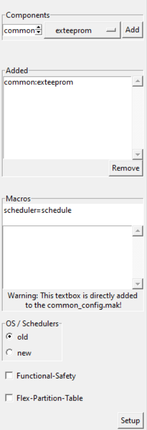
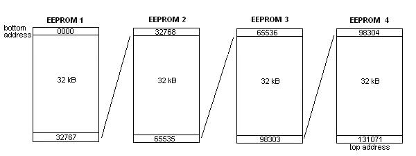

# External EEPROM component

## 1. Introduction

The external EEPROM (exteeprom) component provides user application with possibility to read from and write into external EEPROM chips
without concern about 
- how many integrated circuits are used
- how are they connected in electrical circuit
- how are they addressed
- which memory capacities do they have
- which communication protocol do they use

> Note: *I2C communication is supported as default*

## 2. Install

On form **"Framework setup utility"** select **"exteeprom"** from common components list,
then click button **"Add"**.  
Component appears on list **"Added"** below. After click button **"Setup"** component 
and its setting will be installed.



>Note: Component **exteeprom** provides always direct access from/to external chip.
If you want to have EEPROM information cached in RAM (quick access) and organized in variables,
in that case use another component [**nvmem(ext)**](../nvmem/README.md) .

 
## 3. Communication settings

Two kinds of I2C communication drivers are supported:  
- software driven communication via IO pins (HI2C01 package), default setting
- hardware driven communication via internal I2C registers (HI2C02 package)  
  (at the moment available only for STM32F4 and Silicon Labs EFR32BG21)

### 3.1 Software driven communication

To set this communication version override next make variable in your custom **`<MyVariant>.mak`**:  
> hi2c_variant = used_swi2c

>Note: *This version is set as default after setup.*

In your **hi2c01xs.c** module you have to do :  
Set data(SDA), clock(SCL) and write protect(WP) pins according to connection with EEPROM chip.  

In your **ExtEEPlibXS.c** module you have to do :  
Select EEPROM chip size :
  - EEPROM_2_KBIT
  - EEPROM_4_KBIT
  - EEPROM_8_KBIT
  - EEPROM_16_KBIT
  - EEPROM_32_KBIT
  - EEPROM_64_KBIT

>  For other sizes you have to write your own function versions according to EEPROM chip communication protocol.  

Set EEPROM chip count available on i2c bus :
```c
#define CHIPS_COUNT  1
```
Adapt array EXTEEP_tChipInfo[] according to available chip count, connected on i2c bus. Up to 8 chips available for some types.  
In case you use only 1 chip, to reduce code size you may to create next definition in your custom **`<MyVariant>.mak`**:  

`defines += GSW_USE_SINGLE_MEMORY_CHIP`


### 3.2 Hardware driven communication

To set this communication version override next make variable in your custom **`<MyVariant>.mak`**:  
> hi2c_variant = used_hwi2c

>Note: *After variable change you have to call "make init", as necessary files need to be copied to app folder*

In your **ExtEEPlibMcXS.c** module you have to do:
Select EEPROM chip size :
  - EEPROM_2_KBIT  
  - EEPROM_4_KBIT  
  - EEPROM_8_KBIT  

> At the moment only memories up to 8 kBits are supported

Select I2C hardware unit for communication for next functions:
  - EXTEEP_bRead()  
  - EXTEEP_bWrite()  
  - EXTEEP_tGetStatus()  
  - EXTEEP_ucHandleTask()  

Adapt parameters in EXTEEP_tChipForUnitX*[] according to real parameters of available EEPROM chip.  
Only 1 chip is supported.  
> *X - HW unit number

 
## 4. Memory space
More EEPROM chips can be connected on one bus. Every single memory chip has its own memory space starting from address 0.
All memories together create virtual memory space see picture below :



You need to make proper settings in EXTEEP_tChipInfo[] to describe every used chip.

> Note: *In case only one memory chip is used, virtual memory space is identical with real memory space of this chip*.

## 5. Interface functions

The main interface comprises following functions:

### 5.1 `EXTEEP_bRead`
Function accesses external EEPROM for read. Function only prepares data for read. Then is to be call the function EXTEEP_ucHandleTask()
so many times until the function EXTEEP_tGetStatus() returns EEP_READY.

### 5.2 `EXTEEP_bWrite`
Function accesses external EEPROM for write. Function only prepares data for writing. Then is to be call the function EXTEEP_ucHandleTask()
so many times until the function EXTEEP_tGetStatus() returns EEP_READY.

### 5.3 `EXTEEP_bWriteByte`
Function accesses external EEPROM for writing a single data byte. Function only prepares data for writing.
Then is to be call the function EXTEEP_ucHandleTask() so many times until the function EXTEEP_tGetStatus() returns EEP_READY.

### 5.4 `EXTEEP_tGetStatus`
Function returns status of external EEPROM component.

### 5.5 `EXTEEP_ucHandleTask`
Function handles read/write task steps.

### 5.6 `EXTEEP_vVerify`
Function sets status of memory write process verification.
After status was set to true, next call of EXTEEP_bWrite or EXTEEP_bWriteByte will read every written data and compare each other.

> Note : Function not available if "GSW_USE_SINGLE_MEMORY_CHIP" defined.


## 6. Code examples

### 6.1 Initialisation
```c
  bool initResult

  initResult = EXTEEP_ucHandleTask();
```

### 6.2 Read
```c
uint8_t readData[10];
bool    readResult;

readResult = EXTEEP_bRead(START_ADDRESS, readData,(uint16_t)(sizeof(readData)));
if ( readResult != false )
{
    do
    {
        (void)EXTEEP_ucHandleTask();
    }
    while (EXTEEP_tGetStatus() != EEP_READY);
}
```

### 6.3 Write

```c
uint8_t writeData[] = {1, 2, 3, 4, 5};
bool writeResult;

EXTEEP_vVerify(false);  //true if necessary
writeResult = EXTEEP_bWrite(START_ADDRESS, writeData, (uint16_t)(sizeof(writeData)));
 if ( bWriteResult != false )
{
    do
    {
        (void)EXTEEP_ucHandleTask();
    }
    while (EXTEEP_tGetStatus() != EEP_READY);
}
```