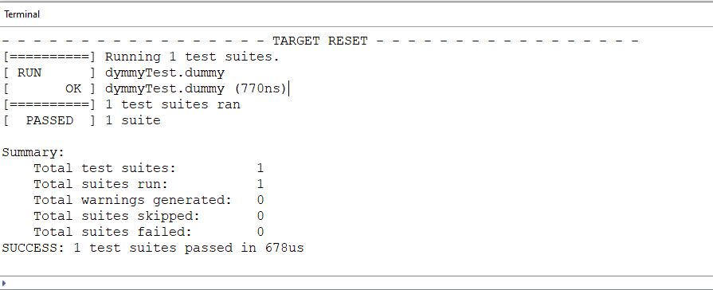
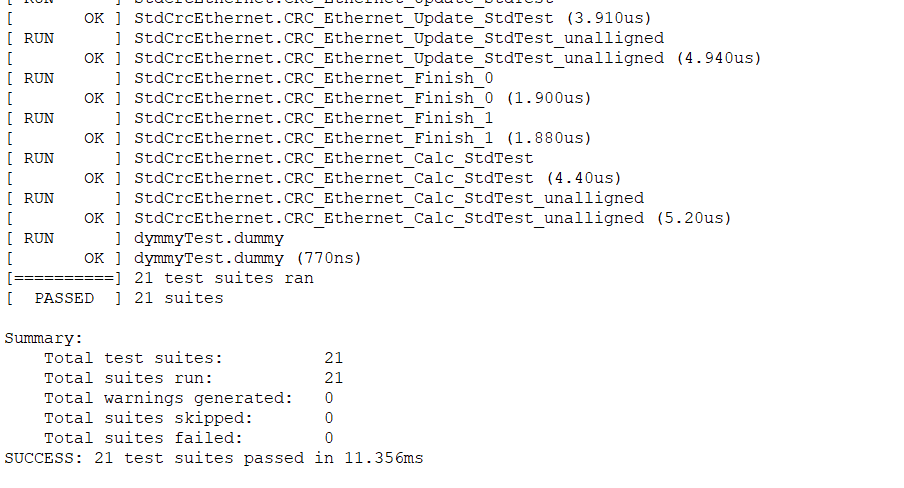

<div align="center">

<h1>Usage of Tau τ in the MCU Framework</h1>


</div>

# Why using Tau τ
τ has been integrated to the MCU Framework for unit tests which are related to the hardware. E.g. a driver of a CRC unit a flash driver or a driver for external EEPROM might be tested using τ. This test framework is really tiny it takes about 20k on a Cortex M0. So unit and integration tests can be done even on small MCUs. For detailed information about τ please refer to the [τ-manual](docs/README.md).

# Limitations
Tau τ is a simple unit test framework, but accordingly the features set is limited. E.g. there is no mocking framework integrated. When there are no hardware dependencies (like in StdCrc), it is recommended to use the DocTest unit test framework instead, which is much more convenient, as no target hardware is needed. Also it gives feedback in a few seconds.

# Write first unit test for the application part or external component
## 1. First start a build for tautest:
```cmd
make variant=tautest init
```
This initializes the tautest variant.


## 2.  Run build for tautest:
```cmd
make variant=tautest
```
## 3. Flash the target
If linking was successful you might flash the target. To do so, you need to connect a JLink to your target.
```cmd
make variant=tautest JLink
```
## 4. View test results
The default interface to print the test report is the Segger RTT. To view the results you can connect using the JLinkRTTViewer.
It seems that this does not work an all systems. Alternatively you can start ozone, load the elf-file and open a terminal (not console).
Resetting or power-on the target delivers the first test report.



For demonstration there is a first dummy test executed. To add your own test you need to do the following few steps.

## 5. Add the component you like to test to file tautest.mak
```makefile
# file app/\<project\>/build/tautest.mak
# add your application specific components here
app_components = myComponent

# external components
ext_components = myExtComponent
```
## 6. Adapt the build.mak of the component you like to test. Units with unit test shall be added to build process by adding them to _ut_src_ instead of _src_
```makefile
# unit with according unit test files: myComponent/test/myUnit.ttest.cpp
ut_src += myComponent/myUnit.c
```
## 7. Create the unit test file myComponent/test/myUnit.ttest.cpp:
```c
//file: myComponent/test/myUnit.ttest.cpp
#include "int_math/sqrt.c"
#include <tau/tau.h>

TEST(TestSuiteName, TestName)
{
    CHECK_EQ(4,5); // fails as 4 != 5
}
```
## 8. Compile and flash the first test
To build and flash in one step:
```cmd
make variant=tautest JLink
```
## 8. View test results
Go back to step 4

# Write first unit test for common components
## 1. Compile and flash the first test
To build and flash the common tau unit tests:
```cmd
make variant=ttest JLink
```
## 2. View test results
The default interface to print the test report is the Segger RTT. To view the results you can connect using the JLinkRTTViewer.
It seems that this does not work an all systems. Alternatively you can start ozone, load the elf-file and open a terminal (not console).
Resetting or power-on the target delivers the first test report.



## 3. Adding additional component for testing
In this example math is added to test build
```makefile
# file: common/build/variants/ttest.mak
ut_common_tests  += ped_fw/stdcrc math
```

## 4. Modify the component build file
Instead appending to the make variable *lib_src*, you need to append to *ut_lib_src*. In this case the according test math/test/mathDiv.cpp will be compiled in case of test build.
```makefile
# file: common/prog/math/build.mak
ifndef math_build_mak
math_build_mak := 1

# in case of tau test math/test/mathDiv.cpp will be compiled
ut_lib_src += math/mathDiv.c

endif
```

## 4. Write the first test for a selected unit
The test implementation includes the implementation of the unit under test, this also allows the test of static functions.
```c
//file: math/test/mathDiv.cpp
#include "math/mathDiv.c"
#ifndef __NOT_CC__ // no static code analysis
#include <tau/tau.h>

struct MTDIV_Result div_result;

TEST(MTDIV_div_mod, dividend_is_0)
{
    div_result = MTDIV_div_mod(0, 10);
    CHECK_EQ(div_result.quotient,  0);
    CHECK_EQ(div_result.remainder, 0);
}
...
#endif
```
## 5. View test results
Refer step 2